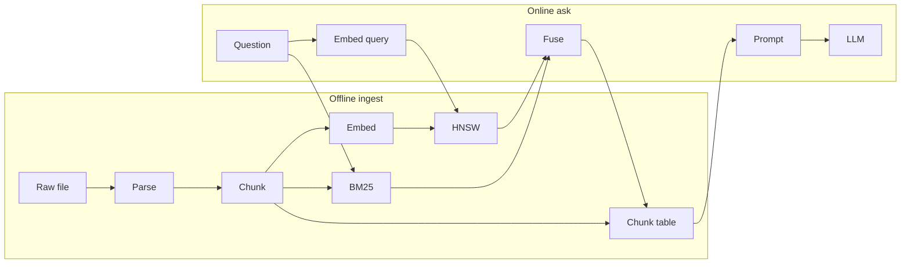

# RAG, from the components up

Retrieval-augmented generation. The model answers from passages you fetched, not from weights alone. Interview numbers and the product boxes live in `systemdesign/enterprise_kb_agent.md`. This note is the mechanism. Memory layers live in `rag&memory_system.md`: a retrieved chunk is long-term memory injected into working memory. It is not the session transcript and not the KV cache.

## What the whole thing is

**What.** Two planes. Offline, documents become chunks, vectors, and a keyword index. Online, a question becomes a few of those chunks, those chunks go into the prompt, and the model writes an answer that has to point at them.

**Why.** Three limits of a bare model. The weights were frozen at training time, so yesterday's contract is not in them. The context window is a fixed token budget (`max_position_embeddings` plus the KV cache that has to fit on the GPU), so a 1000-page PDF cannot be the prompt. A prompt with no evidence still produces fluent text. RAG mounts private, current text beside the model. It does not fine-tune the model.

**How.** Ingest once. Ask many times. The ask path never parses a PDF.

```text
offline   bytes → parse → chunk → embed → HNSW + BM25 + chunk table
online    question → embed → nearest ids + keyword ids → ACL → hydrate text → prompt → generate
```



Same `chunk_id` in the vector index, the keyword index, and the chunk table. The index returns ids. The table returns the paragraph the model actually reads.

## 1. Raw document

**What.** The file bytes, plus a metadata row: `document_id`, tenant, ACL, checksum, status, where the bytes live.

**Why.** The index is a derived view. You re-parse when the parser improves, and you download the original for a human. Object storage cannot answer "is this doc READY?" or "who may read it?" A bucket listing is not a catalog.

**How.** Insert the metadata row first, then store the bytes, then enqueue ingest. Status moves `UPLOADED → PARSING → CHUNKING → EMBEDDING → READY`. A poison file becomes `FAILED` and is not searchable. The same `document_id` plus checksum makes a retry idempotent. This is a long task: a 1000-page PDF is minutes, with a cursor, not part of the 2-second ask.

## 2. Parser

**What.** Bytes turned into a list of blocks: headings, paragraphs, and tables, each with a page number and a box on the page. The output the rest of the pipeline stores is Unicode text, serialized as UTF-8 JSON. It is not one long string.

**Why.** The embedding never sees the PDF. It sees whatever the parser emitted. A heading that was dropped, or a two-column page read across instead of down, becomes a chunk that can never be retrieved for the right question.

**How.** A worker, offline. Two kinds of page enter it. A digital PDF already stores glyphs plus a mapping to characters (often a ToUnicode table, sometimes WinAnsi or a custom font encoding). The parser reads those content streams and the position of each span. A scanned page has no text layer, only an image, and OCR reads the pixels into characters with boxes. Both paths end in the same blocks. The PDF's internal encoding stops here. After that every string is Unicode code points written as UTF-8.

Keep the heading path and the page number on every block. Chunking copies them onto each chunk. The citation points at that page, and a metadata filter uses the path. `bbox` is the box in PDF points, origin usually bottom-left. It is how two columns stay two columns. Reading the page as one left-to-right line glues the left column to the right, and that glued sentence is what gets embedded.

A table is both a grid and a markdown string. The grid keeps "Seat" in the same row as its fee. Flattening the cells into one sentence loses that. The embedding and the prompt see `text`. The page and the heading path stay beside it.

```json
{
  "doc_id": "msa-2024",
  "pages": [
    {
      "page": 1,
      "width": 612,
      "height": 792,
      "blocks": [
        {
          "block_id": "p1-b0",
          "type": "heading",
          "level": 1,
          "text": "Master Services Agreement",
          "heading_path": ["Master Services Agreement"],
          "bbox": [72, 720, 540, 748]
        },
        {
          "block_id": "p1-b1",
          "type": "heading",
          "level": 2,
          "text": "4. Termination",
          "heading_path": ["Master Services Agreement", "4. Termination"],
          "bbox": [72, 680, 540, 700]
        },
        {
          "block_id": "p1-b2",
          "type": "paragraph",
          "text": "Either party may terminate this agreement for convenience with 30 days' written notice.",
          "heading_path": ["Master Services Agreement", "4. Termination"],
          "bbox": [72, 640, 540, 675]
        }
      ]
    },
    {
      "page": 2,
      "blocks": [
        {
          "block_id": "p2-b0",
          "type": "table",
          "heading_path": ["Master Services Agreement", "5. Fees"],
          "bbox": [72, 500, 540, 620],
          "rows": [["Item", "Fee"], ["Seat", "$40 / month"]],
          "text": "| Item | Fee |\n| Seat | $40 / month |"
        }
      ]
    }
  ]
}
```

## 3. Chunk

**What.** One piece of that parsed text, with a stable id. Fields worth having: text, `doc_id`, page range, heading path, parent id, tenant, ACL.

**Why.** One vector has to stand for one meaning. A whole manual averages a thousand topics into one point, and nearest-neighbor search cannot land on the termination clause. A tiny slice cuts the clause in half, so neither half looks like the question. The chunk is the unit of retrieval. The parent section is the unit you can stand to show the model.

**How.** This file uses two methods together. The cut is structure-aware chunking (结构化切分, 按标题和段落切). Headings are not embedded. Each paragraph or table under a heading becomes one chunk of about 300–800 tokens, with 10–20% overlap when a section is longer than that, so a sentence on the boundary is whole in one of the chunks. The prompt uses parent-child chunking, also called small-to-big (父子切分, 小块检索、大块生成). Search returns the small chunk. The model sees the parent section.

On the parsed contract above, `p1-b0` and `p1-b1` only set `heading_path`. They are not chunks. `p1-b2` becomes the termination chunk. `p2-b0` becomes the fees chunk. `embed_text` is the only string that becomes a vector. The heading path is prefixed so the point means "termination inside this agreement," not a bare sentence.

```json
[
  {
    "chunk_id": "c-term",
    "doc_id": "msa-2024",
    "page": 1,
    "block_ids": ["p1-b2"],
    "parent_id": "sec-4",
    "heading_path": ["Master Services Agreement", "4. Termination"],
    "embed_text": "Master Services Agreement > 4. Termination\nEither party may terminate this agreement for convenience with 30 days' written notice."
  },
  {
    "chunk_id": "c-fees",
    "doc_id": "msa-2024",
    "page": 2,
    "block_ids": ["p2-b0"],
    "parent_id": "sec-5",
    "heading_path": ["Master Services Agreement", "5. Fees"],
    "embed_text": "Master Services Agreement > 5. Fees\n| Item | Fee |\n| Seat | $40 / month |"
  }
]
```

The parent of `c-term` is the section, rebuilt from the blocks under that heading:

```json
{
  "parent_id": "sec-4",
  "page": 1,
  "text": "4. Termination\nEither party may terminate this agreement for convenience with 30 days' written notice."
}
```

"How do we end the contract?" lands on `c-term`. The prompt gets `sec-4`. `c-fees` stays out. This sentence is already one chunk, so there is no overlap to apply. Splitting it into "Either party may terminate this agreement" and "with 30 days' written notice" makes the question close to neither half. A real section of 300–800 tokens is several paragraphs under the same heading. The parent is still the whole section. A 1000-page file is about three chunks a page, about 3000 vectors, embedded once.

### Other ways to cut

The most common method in frameworks is recursive character splitting (递归字符切分): try a blank line, then a newline, then a space, and stop at a fixed size with overlap. It needs no headings, which is why it is the default. It does not know that "4. Termination" is a section.

The size is not an embedding. The embedder has not run, and the chunker does not need a vector to know how long a string is. The usual recursive splitter counts characters: `chunk_size=1000` means 1000 characters. A token-aware splitter counts with a tokenizer, a local table that turns text into token ids (BPE, the same family the model uses). That count is a few milliseconds of string processing. "300–800 tokens" in this note is that count, so the chunk will fit the context window. It is not the output of the embedding model.

| Method | 中文 | How it cuts | Use it when |
|---|---|---|---|
| Recursive character split | 递归字符切分 | Fixed character count, or a tokenizer count, with overlap. Break at paragraphs, then spaces | No headings. The usual default |
| Fixed-size window | 固定长度切分 | Every N characters or tokens, overlap, ignoring sentences | A quick baseline. Cuts clauses in half |
| Structure-aware | 结构化切分 | A heading starts a section. The section is one chunk if it is under the token limit. A longer section is split again, and every piece keeps that heading | PDFs and HTML with a real outline. This note's cut |
| Parent-child (small-to-big) | 父子切分 | Search the small chunk, show the parent section | The hit is precise and the model still needs the surrounding clauses. This note's prompt |
| Sentence window | 按句子切分 | One sentence, plus the sentences beside it at prompt time | Short factual questions |
| Semantic split | 语义切分 | Embed each sentence, start a new chunk when similarity drops | Essays with no headings. Costs an embedding per sentence |
| LLM split | 模型切分 | A model decides the boundaries | Messy text, and the ingest bill matters less than the cut |

A heading is joined to the text by a size rule, not by the embedder. "4. Termination" alone is not a chunk: the vector would match the question and contain no answer. The heading starts a section, and the following paragraphs belong to it until the next heading of the same or higher level. If that section is under the limit, about 300–800 tokens by the tokenizer, heading and body are one chunk, and the heading is also prefixed onto `embed_text`. If the section is over the limit, the recursive splitter cuts only inside it, and every piece gets the same heading prefix. A section under a minimum, a heading with no body, is merged into the next section rather than embedded alone. The table in the contract stays one chunk because a row split apart stops meaning "Seat costs $40."

## 4. Embedding

**What.** A smaller model that maps a text to one vector, a few hundred to a couple thousand floats. The same model (or a matched query/document pair) embeds chunks offline and the question online.

**Why.** "Termination" and "ending the agreement" share almost no tokens and should still land near each other. The vector is a point such that texts with similar meaning have a high dot product or cosine. Search becomes geometry.

**How.** Batch the chunks on a GPU during ingest. On the ask path you embed only the question, about 20–40 ms. Do not re-embed the corpus per question. The vector's dimension is fixed by that model. Changing the embedding model means rebuilding the index. The vector does not store the paragraph.

The model still tokenizes the chunk and gives each token its own vector. Pooling, which an LLM does not do, collapses those vectors into the one vector the index stores.

`embed_text` for the termination clause is split into token ids by a byte-pair tokenizer, the same kind an LLM uses. A short special token is often placed at the front or the end. Each id is looked up in an embedding table, so the input is one vector per token plus a position. A transformer then rewrites every token using the others: the vector at `terminate` comes to depend on `30 days` and on the heading. You still have one contextual vector per token.

Pooling keeps a single vector and drops the rest:

- CLS pooling keeps the leading special token, trained to summarize the sequence.
- Mean pooling averages every token's vector.
- Last-token pooling keeps the final token. Decoder-style embedders often do this.

A small linear layer may shrink that vector to the model's fixed size, and it is usually normalized so a dot product is a cosine. The token vectors are not stored.

`terminate` and `ending` stay different tokens. Training pairs a question with a passage that answers it and pulls those two pooled vectors together, and pushes unrelated passages apart. The words do not match. The points do.

An LLM keeps the per-token vectors because it predicts the next token, and the KV cache holds them. An embedding model is a smaller encoder, or a decoder used only as an encoder, trained with that pairing loss. After pooling, the per-token states are discarded. A matched query/document pair means the same model with a `query:` or `passage:` prefix, or two encoders, so the question and the chunk are mapped into one space.

## 5. Vector index

**What.** An approximate nearest-neighbor structure over those vectors. HNSW is the usual graph: several layers of links, search starts coarse and walks toward the query vector.

**Why.** Exact cosine against every chunk is a scan. At corpus size that scan misses the latency budget. A B+ tree answers equality and range. It does not answer "nearest point in 1024 dimensions."

**How.** The index stores the vector, the `chunk_id`, and small filter fields (tenant, maybe year). It does not store the paragraph. Query: embed the question, walk the graph, return ids. `efSearch` trades recall for latency. Filter tenant and ACL with the walk or immediately on the ids. Filtering after you have already filled the prompt is too late. Postgres with pgvector is enough when ask traffic is tens of QPS and the index fits: the chunk table, the ACL, and the vectors can live in one database. When the graph outgrows that, move only the nearest-neighbor structure to a vector engine and leave the text where it is.

Vectors are not sorted. A skip list walks a line because each key has a next-larger key. A vector has no next vector. NSW is one graph: every chunk is a node, and an edge means this vector was among the node's neighbors when it was inserted. Greedy search starts at an entry node and steps to the neighbor closest to the query, stopping when no neighbor is closer. One flat graph of millions of points needs many short steps, and a bad entry point leaves the walk in the wrong region.

HNSW adds the skip-list shape without an order. Each point draws a random top layer, with a geometric drop-off, the same coin-flip as a skip-list height. Layer 0 holds every point. Each layer above holds a random subset. A point on layer 2 also sits on layers 1 and 0, with its own links on each. Upper layers are a sparse sample of the same space, so a hop there crosses a large region. Nothing is arranged left to right.

```text
layer 1     A ----------- E          few nodes, long links
layer 0     A -- B -- C -- D -- E -- F
                 \_______/
query                         *
```

Search starts at A on layer 1, steps to E because E is closer to the query, then drops to layer 0 at E. There D is closer, then C. C's neighbors are all farther, so C is the hit. The layers did not sort A, B, C. They decided which points exist high up. The edges decided who can be stepped to.

Insertion is that walk run ahead of time. A new point draws its top layer, searches down to the closest nodes on each layer it belongs to, and links itself to about M of them. A node with too many links drops some, preferring neighbors that point different ways so the graph does not collapse into clumps. The links mean "who is near me," which is why a later query can walk toward wherever it sits.

A projection onto one axis cannot replace the links. Two nearby vectors land far apart when they differ on the other dimensions. The comparison is computed at search time: distance from a neighbor to this query. `efSearch` is how wide the layer-0 walk is. A larger value keeps more candidates than the current closest, so one greedy mistake can still be recovered.

## 6. Keyword index

**What.** An inverted index, BM25. Tokens point at `chunk_id`s. Score is term frequency times inverse document frequency, with a length normalization.

**Why.** A clause number, an SKU, or "第12条" is an exact string. The embedding often smears it. Vectors win on paraphrase. Keywords win on identifiers.

BM25 (Best Matching 25) is the ranking function on that inverted index. Grep only answers "the string occurs." BM25 answers "which chunk should come first." For each query term it adds three effects. A rare term counts more than a common one, the inverse document frequency: "第12条" moves the score, "agreement" barely does. Repeating a term saturates, controlled by `k1`: the tenth "termination" in one chunk adds less than the first, so a chunk cannot win by stuffing the word. A long chunk is normalized against the average chunk length, controlled by `b`, so a 800-token section that mentions the term once is not beaten by a 50-token scrap, and it does not win merely by being long. The score of a chunk is the sum of those per-term terms. That is what is special about it relative to a boolean scan and relative to raw term frequency. It still cannot match "ending the agreement" to "termination." That remains the vector list.

**How.** Tokenize the chunk at ingest, alongside the embedding. At query time, run BM25 on the raw question (and on a keyword-shaped rewrite if you have one). Fuse with the vector hits by reciprocal rank. BM25 scores and cosine scores are not on the same scale, so only the position in each list is used: a chunk adds `1 / (60 + rank)` for every list it appears in. Same `chunk_id` space, so fusion is a sort over ids, not over text.

For "end the contract in 30 days":

```text
vector list    1. c-other    2. c-term    3. c-fees
keyword list   1. c-days     2. c-term    3. c-fees

c-days   1 / (60 + 1)                 = 0.016    rank 1 in the keyword list only
c-term   1 / (60 + 2) + 1 / (60 + 2)  = 0.032    rank 2 in both
```

`c-days` contains "30 days" and is about something else. `c-term` is only second in each list, and it wins. A chunk that is rank 1 in one list and also present in the other still beats `c-term`, because that score is `1/61` plus another positive term. The comparison is "both lists" against "only one list."

### Why RAG, and when grep is enough

RAG exists because the weights are frozen, the window cannot hold the corpus, and a prompt with no passage still produces an answer. Grep does not fix any of those three. It is another way to choose the passage. The claim "grep beats RAG" is about that choice, and it is often right.

Grep (or ripgrep) scans files for a literal string. BM25 is the same idea with an inverted index, a score, and ids. Use grep when all of these hold:

- The corpus is a tree on disk, small enough to scan, and it changes under you. A vector index is stale until the next embed. Grep sees the file as it is now. This is a coding agent over one repo.
- The question already contains the rare string: a function name, an error code, a clause number. The embedding smears that string. A chunk boundary may also cut the function in half, so the vector never meant the symbol.
- An agent can search, then open the file. That read is parent expansion, done by a tool call instead of by a stored parent id. Several cheap greps fit in a coding session. They do not fit a 2-second Q&A budget.

Use the embedding side when any of these fail:

- The words in the question are not the words in the document ("ending the agreement" versus "termination"). Grep returns nothing. Cross-lingual is the same gap.
- The corpus is not a tree you may scan: PDFs in object storage, a multi-tenant catalog, millions of chunks. Grep has no ACL and no latency bound.
- The product is one answer, not a loop of searches. A shopper will not wait for eight greps.

So a coding agent should grep first and embed only when the string is unknown. A knowledge-base ask should run keyword and vector together and fuse the ids. Dropping the vector half and calling the keyword half "grep" is reasonable. Dropping retrieval and hoping the model remembers the corpus is the thing RAG was built to avoid.

## 7. Chunk table

**What.** The text and the fields a prompt and a citation need, keyed by `chunk_id`.

**Why.** The graph and the inverted index are about finding ids quickly. Hydrating a paragraph out of them is the wrong shape, and you do not want two copies of the text drifting apart.

**How.** After fusion, look up the surviving ids. This is the first moment the ask path holds prose. Parent expansion happens here: you may replace or accompany the small chunk with its parent section before the prompt is built.

## 8. Query understanding, in front of retrieval

**What.** A rewrite of the user message into something that can be embedded and keyword-matched on its own. Optional metadata pulled out of it (year, doc type).

**Why.** "The cheaper red one" is a bad vector. It depends on the previous turn. Multi-turn lives in the session store; retrieval does not see that store unless you fold the needed part into the query string.

**How.** Load the recent turns. One call, or a rule, produces a standalone query plus filters. If a required slot is missing ("which contract?"), ask the user and do not retrieve yet. Several searches — keyword, semantic, one per sub-question — are the multi-dimensional case. Fuse them the same way as hybrid search. This step is not the generator. It only builds the retrieval request.

## 9. ACL

**What.** A filter: this principal may see this chunk.

**Why.** The model will quote whatever you put in the prompt. A check after the answer is a leak you already generated.

**How.** The principal comes from the auth token, not from a `user_id` in the body. Chunks carry the ACL copied from the document at ingest. Drop forbidden ids before hydration. A shared index plus a filter is the starting point. Physical isolation (index and bucket per tenant) is a compliance choice, not a recall trick.

## 10. Reranker

**What.** A cross-encoder. It reads the query and one chunk together and emits a relevance score. You run it on the fused top 20–50, then keep 4–8.

**Why.** The bi-encoder scored query and chunk separately, which is why it could be indexed. It never looked at the pair. The cross-encoder is more accurate and too expensive to run on the whole corpus.

**How.** Optional on the ask path, about 50–150 ms. Skip it when the hybrid top hit is already an exact keyword match. It is one of the first things to turn off when latency or GPU budget slips. It reorders. It does not find chunks the first stage missed, so recall@k of the first stage still bounds the system.

The embedding model encodes the question and the chunk separately, which is why the chunk vector can be stored ahead of time. A cross-encoder cannot. Each token of the chunk is computed while looking at the question, so the same chunk gets a different internal representation for every query. Nothing about this score is written to the index.

For one candidate, build one string with the separators the model was trained on: `[CLS] how do we end the contract? [SEP] Master Services Agreement > 4. Termination. Either party may terminate ... [SEP]`. Tokenize it as one sequence, so `end` can attend to `terminate` and to `30 days`. Run a small transformer, usually a BERT-sized encoder, not the generator. A linear layer on one position of that sequence emits a single relevance logit. A sigmoid turns it into a probability that the pair matches. It is not a cosine.

`[CLS]` is not a word from the question or the chunk. The tokenizer inserts it. A BERT vocabulary has a row for it, id 101 in the original BERT, and the embedding table maps that id to a learned vector of the same width as every other token. It is written at position 0, then the question, then `[SEP]`, then the chunk. Self-attention rewrites position 0 using every token in the pair, and the classification head reads only that updated vector. A decoder-style reranker often has no `[CLS]` and reads the last token instead. That position has the same job: one vector that was allowed to see the entire pair.

Training uses labeled pairs or triples. A relevant chunk is pushed toward a high score, and a random or hard negative toward a low score, with binary cross-entropy or a pairwise loss. At query time this runs only on the 20–50 ids hybrid search already kept. One pair per id, batched on a GPU, sorted by the logit, and the top 4–8 are kept. `c-term` scores high for "how do we end the contract?" because the joint attention sees `terminate`. `c-fees` scores low because `$40` never lines up with ending a contract. Fifty short forwards of a small model is the 50–150 ms. A chunk the first stage never returned has no pair to score.

## 11. Prompt and generator

**What.** The prompt is the system rule, the hydrated chunks each wrapped with its `chunk_id` and page, and the question repeated after the chunks. The generator is one model call over that prompt.

**Why.** Retrieval returned passages. The user asked for an answer. The model is the writer. The window is why you send 4–8 chunks and not 3000. Lost-in-the-middle is why the question sits at the end, not buried in the passages. The citation rule is why a sentence must name a `chunk_id` that was actually in the prompt, or the product says it cannot confirm.

**How.** Stream tokens. Check that each cited id was in the retrieved set, and that a quoted span occurs in that chunk. No citation, no claim. Cost sits here: the prompt of several chunks plus the system text is most of the inference bill. Cutting 8 chunks to 4, or skipping generation when a high-confidence extractive quote is enough, is the cost lever. Rebuilding the HNSW is not.

Latency shape for one ask, from the knowledge-base design: auth ~20 ms, embed the query ~20–40 ms, hybrid retrieve ~50–150 ms, optional rerank ~50–150 ms, time to first token ~400–1200 ms. The scarce resource is the generator, not the 18 QPS of retrieval.

## 12. Where this sits in the agent loop

**What.** RAG is a read of the long-term store into working memory, then one model call. An agent may wrap that read in a tool and decide whether to call it.

**Why.** A fixed pipeline retrieves on every question, including "hello" and "what did I just ask?". An agentic loop can call search, call it again with a different query, or skip it. The loop is the same ReAct loop as elsewhere: the tool result is appended, and the next call sees the passages. The passages are not session memory until that append is persisted.

**How.** As a pipeline, the ask service always runs steps 8–11. As a tool, the model emits `search(query)`, the runtime does the retrieve, and the chunk text comes back as a tool result. Cap the calls. Two searches per question is plenty. The model does not pick the ACL and does not write the index.

## What to measure

Retrieval and generation fail differently, so they get different numbers.

You need a labeled set: a question and the `chunk_id`s (or pages) that contain the answer. Recall@k is how many of those gold ids appear in the top k. Hit rate is whether at least one does. MRR is how high the first hit ranks. nDCG rewards a hit that ranks above a miss. Gate on recall@k per document type before you ship. A long contract and an FAQ do not share a threshold.

Faithfulness and "did the answer cite the right passage" measure the generator. A perfect retriever with a model that ignores the chunks still fails those. A perfect answer with the wrong chunk in the prompt fails recall. Do not use one number for both.

## Choosing the pieces

| Decision | Take the simpler side when | Move up when |
|---|---|---|
| Cut size | Heading-sized 300–800 tokens, overlap, parent stored | A clause is still split, or the vector mixes two topics |
| Vector store | pgvector next to the chunk table | Index size or latency no longer fits one Postgres |
| Keyword index | You have clause numbers, SKUs, error codes | Pure paraphrase and no exact tokens |
| Grep vs an index | One repo on disk, and the query names a symbol | PDFs, tenants, ACL, or a 2-second budget. Grep sees fresh files; it does not rank a corpus or enforce ACL |
| Rerank | First-stage top hit is already obvious | The right chunk is in the top 50 but not the top 5 |
| Rewrite | The question is standalone | The question is "it" / "the red one" |
| Agent vs pipeline | Every ask should search | The model must choose whether, and what, to search |
| Generation | A quote plus a citation is the product | The user needs a synthesis across several chunks |
