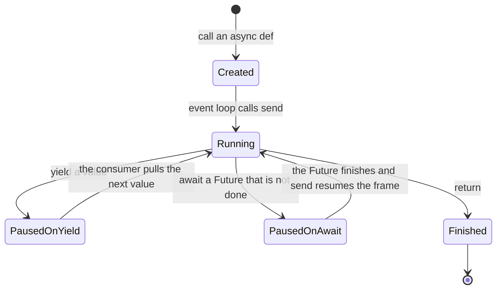
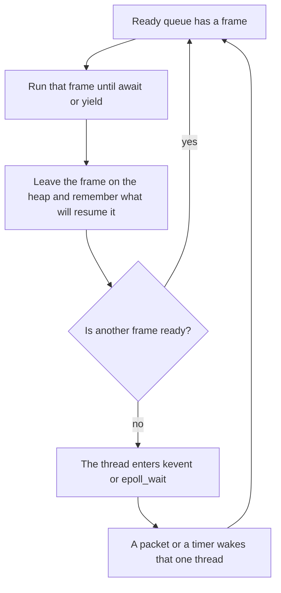

# Asyncio and yield, from the A2A adapter down to the kernel

A request on `POST /a2a` does not get a process, and it does not get a thread. Uvicorn runs one event loop on one OS thread. Each in-flight request is a coroutine: a Python stack frame that lives on the heap. Hundreds of those frames can be paused at once. The kernel parks that one thread only when every frame is paused and the loop has nothing left to run.

Java has all three of the mechanisms below. AgentScope uses each of them in a different place. The adapter uses the first one.

| What is paused | Python in this repo | Java | Kernel object |
|---|---|---|---|
| One request waiting on the model or on Nacos | `async def` + `await` | A virtual thread parked on I/O, or a Netty callback waiting on a `Selector` | None. A heap object. The OS thread keeps running other requests. |
| The server thread with no runnable request | The loop inside `kevent` / `epoll_wait` | `Selector.select()`, or `EventLoopGroup` blocked in `epoll_wait` | One thread, state interruptible-sleep, on the fd wait queue |
| A separate server | `subprocess.Popen(..., start_new_session=True)` in `process_manager.py` | `ProcessBuilder.start()` | A new PID and address space |

## One coroutine, as a graph

One coroutine is a heap frame. The event loop runs that frame until it hits `await` or `yield`, then runs a different frame. The thread enters the kernel only when the ready queue is empty.



`Created` means the frame exists and has not run. Calling `stream_query(...)` or `execute(...)` stops here. `POST /a2a` moves only when uvicorn’s loop calls `send`.

`PausedOnYield` is `async for` in `A2AExecutor.execute`. `stream_query` hits `yield`, the frame freezes, and `execute` receives the event. The next pull resumes on the line after `yield`.

`PausedOnAwait` is `await self._call_model(...)`. The socket `Future` is still pending, so the frame stays on the heap. The loop does not sit inside that function.

While any frame is `Running`, it is the only Python running on that thread. The others wait in one of the two paused states.



On the model call, “what will resume it” is the socket becoming readable. On `yield`, it is `execute` asking for the next event. Five hundred paused requests are five hundred frames plus five hundred fds, and one thread in `kevent` when none of them is ready.

Read this first: [A conceptual overview of asyncio](https://docs.python.org/3/howto/a-conceptual-overview-of-asyncio.html), sections “Event loop” and “Asynchronous functions and coroutines.” Calling an `async def` only builds the coroutine, and `await` is the point where that job gives the loop back control. The API reference after that page is [Coroutines and tasks](https://docs.python.org/3/library/asyncio-task.html).

## The adapter is two different pauses

`A2AExecutor.execute` pulls an async generator and keeps only the finished reply:

```54:60:basicKnowledge/Agent/agentframeWorks/agentscope/agentscope-runtime/src/agentscope_runtime/engine/deployers/adapter/a2a/a2a_agent_adapter.py
            async for event in self._func(request=request):
                if event.object == "response":
                    if event.status == RunStatus.Completed:
                        if event.output:
                            message = event.output[len(event.output) - 1]
                            a2a_message = agent_message_to_a2a_message(message)
                            await event_queue.enqueue_event(a2a_message)
```

`self._func` is the runner's `stream_query`. The request is built with `"stream": True`, so the agent yields many events. The Agent Card says `streaming=False`, so the JSON-RPC client sees one result. The filtering happens in this loop: every event is pulled, and `enqueue_event` runs only for `RunStatus.Completed`.

Those two lines pause for different reasons.

`async for` pauses on `yield`. `stream_query` is an async generator. Calling it returns a generator object and runs nothing. `async for` calls `__anext__`, which runs the generator until the next `yield`, then freezes that frame and hands the value back. `execute` looks at the event. If it is not completed, it pulls again, which resumes the frame on the line after `yield`. The pause lasts as long as the `if` takes. No socket, no system call.

The first two yields in `stream_query` are that kind of pause. They hand out an empty response, then the same response marked in progress, before any model call:

```232:239:basicKnowledge/Agent/agentframeWorks/agentscope/agentscope-runtime/src/agentscope_runtime/engine/runner.py
        response = AgentResponse(id=request.id)
        response.session_id = request.session_id
        yield seq_gen.yield_with_sequence(response)

        response.in_progress()
        yield seq_gen.yield_with_sequence(response)
```

`await` pauses on a `Future`. The long pause is further down the same generator, in the framework agent:

```1721:1734:basicKnowledge/Agent/agentframeWorks/agentscope/agentscope/src/agentscope/agent/_agent.py
        yield ModelCallStartEvent(
            reply_id=self.state.reply_id,
            model_name=self.model.model,
        )

        kwargs = await self._prepare_model_input()

        res = await self._call_model(
            tool_choice=tool_choice,
            **kwargs,
        )
```

`_call_model` writes the HTTP request on a non-blocking socket and returns a `Future` that completes when the socket is readable. `await` stores "resume `_reasoning_impl` with the response" on that `Future` and returns. The frames above it are frozen too: `_reasoning_impl`, the `async for` inside `stream_query`, and the `async for` inside `execute`. They are one chain of heap frames. The loop is then free to accept another `POST /a2a` on the same thread.

When a token chunk arrives, the model async generator yields it, `_reasoning_impl` yields an event, `stream_query` yields that event, and `execute` drops it because the run is not completed. The chain repeats until the completed response, and only then does `await event_queue.enqueue_event(...)` run.

`yield` is the producer handing a value to its consumer. `await` is a frame waiting for a `Future`. In this path the consumer is `execute`, and the `Future` is the model socket.

## What the machine does when a coroutine pauses

CPython compiles `async def` to a code object. Calling the function allocates a coroutine object and a frame on the heap. The frame holds the locals and the instruction pointer. The body does not run until the event loop calls `coro.send(None)`.

At an `await`, the bytecode evaluates the `Future`, then suspends. The eval loop in `ceval.c` saves the instruction pointer into the heap frame and returns out of C. The C stack unwinds back to the event loop. Locals stay in the heap frame. Registers are not saved into a kernel thread struct. The scheduler is not involved. The coroutine is absent from the loop's runnable queue, so it simply does not get `send` again until the `Future` finishes.

`yield` in an async generator is the same heap-frame suspend. The waker is different: the consumer's next `__anext__` call, rather than a socket becoming readable.

Resuming is `coro.send(result)`. The eval loop starts again at the saved instruction, and the value of the `await` expression is `result`.

This is why one thread can hold a thousand paused model calls. Each call is a few kilobytes of frame plus an entry in the kernel's fd interest list. There is no thousand-thread run queue.

The GIL sits on the thread, not on the coroutine. While the loop is executing Python, one thread runs one coroutine's bytecode. Overlap comes from the waits. Two model calls overlap because both sockets are in flight while the thread runs whichever frame is currently resumed. They do not occupy two cores. A second core requires another thread or another process. The detached-process deploy is the place this repo does that.

## What the machine does when the thread itself sleeps

After the loop has resumed every coroutine that has data, it calls the selector. On macOS that is the `kevent` system call. On Linux it is `epoll_wait`. CPython drops the GIL around that call, so another Python thread in the same process can run while the loop thread is inside the kernel.

The system call traps. The CPU writes the user instruction pointer, stack pointer, and flags onto the kernel stack, switches to kernel mode, marks the thread interruptible-sleep, and chains it onto the kqueue's wait queue. The scheduler picks another runnable thread, or the idle thread, which halts the core until an interrupt.

A packet does the reverse. The NIC raises an interrupt, the driver hands bytes to TCP, the socket is readable, and the kernel wakes the thread waiting on that kqueue. The thread becomes runnable. When it is scheduled, `kevent` returns the list of ready fds. The loop completes the matching `Future`s and `send`s those coroutines.

One server thread, one of these sleeps. Five hundred paused requests are five hundred fds registered with that kqueue, and one thread on the wait queue.

`asyncio.sleep` is the same path with a timer instead of a socket. `ProcessManager.start_detached_process` does `await asyncio.sleep(0.5)` after `Popen`, then `process.poll()`, which is `waitpid(WNOHANG)`. The parent coroutine pauses for half a second. The parent thread can run other coroutines during that half second. It does not block in `waitpid`.

## What the machine does for a real process

`LocalDeployManager` has two ways to run the server.

Daemon thread, same process. A new pthread is created. Its target calls `asyncio.run(self._server.serve())`, which builds a second event loop bound to that thread. Event loops are thread-local; the parent thread's loop and the server thread's loop each have their own kqueue. The parent then `await`s `_wait_for_server_ready`, which is `asyncio.sleep(0.1)` in a loop. Both threads can be inside `kevent` at the same time. They share an address space, so a crash in either one takes the process down. In Java this is a platform thread whose body is `Selector.select()`, plus the caller thread parked on a short sleep.

```219:227:basicKnowledge/Agent/agentframeWorks/agentscope/agentscope-runtime/src/agentscope_runtime/engine/deployers/local_deployer.py
        def run_server():
            asyncio.run(self._server.serve())

        self._server_thread = threading.Thread(target=run_server, daemon=True)
        self._server_thread.start()

        await self._wait_for_server_ready(self._startup_timeout)
```

Detached process, new PID. `subprocess.Popen` with `start_new_session=True` ends in `posix_spawn` (or `fork` plus `exec`). The child gets its own PID, its own address space, and its own session, so closing the parent's terminal does not deliver `SIGHUP` to it. `exec` replaces the copied image with a new Python interpreter, which builds its own event loop and its own kqueue. A context switch between parent and child saves registers and switches the page table (`CR3` on x86). That is the expensive park-and-wake. The parent does not `wait` on the child; it keeps the PID and later checks the port.

Nacos registration shows the same split inside the adapter. `_start_register_task` calls `asyncio.get_running_loop()`. If a loop is running, `loop.create_task(self._register_to_nacos(...))` puts another coroutine on that loop. `await NacosAIService.create_ai_service(...)` then pauses only that task; `POST /a2a` on the same loop still runs. If no loop is running, it starts a daemon thread and calls `asyncio.run` there, because `create_task` needs a live loop and a synchronous caller cannot be blocked. `CancelledError` is injected at whichever `await` is pending, the frame resumes, and the `except asyncio.CancelledError` branch shuts the client down. `A2AExecutor.cancel` does not do this. It raises `UnsupportedOperationError` and leaves the in-flight coroutine running.

## Java, side by side

A platform thread is a pthread. `Socket.read()` in the old `java.net` socket, `Thread.sleep`, and `BlockingQueue.take` park that pthread. The kernel does the same trap and wait-queue dance as `kevent`, once per blocked thread. A servlet container that handles a thousand slow model calls with blocking I/O has a thousand parked threads. Each one has a kernel stack, usually a megabyte reserved, and the scheduler has a thousand entries to search. That is the model AgentScope's request path avoids.

A virtual thread (Java 21) is the closest thing to an asyncio task, with one structural difference. The JVM copies the virtual thread's stack onto the heap (`Continuation.yield`), unmounts it from a small pool of carrier threads, and registers the fd with a poller that is itself blocked in `epoll_wait`. On readiness a carrier mounts the continuation and continues. A virtual thread can pause inside an ordinary method that looks synchronous, because the whole stack is the continuation. A Python coroutine can pause only at an `await` written in an `async def`. A plain `def` called from the agent runs to completion on the loop thread. `requests.get` or `time.sleep` inside `execute` would freeze every other request until it returns. The JVM equivalent is pinning a carrier, or calling blocking I/O on a Netty event-loop thread.

Netty, and Spring WebFlux on top of it, is the same design as uvicorn. One event-loop thread, non-blocking `SocketChannel`, `Selector` over `epoll`, callbacks for "bytes arrived." `CompletableFuture.thenCompose` is `await`: the rest of the function is a continuation stored on the future. AgentScope writes that continuation as the lines after `await` in an `async def`, which is easier to read and is the same control flow.

`ExecutorService` with platform threads is the daemon-thread pattern, scaled up. Work runs in parallel on several cores, and a blocking call parks only that worker. The cost is one kernel thread per worker. `loop.create_task` does not do this. It appends a heap frame to the current loop's queue. The Nacos path uses `create_task` when it is already on the server loop, and a real `Thread` only when it has no loop.

A process is `ProcessBuilder` or `Popen`. Separate address space, separate GIL, separate crash domain. Function Compute does this one level higher: the deployed function is a process whose whole job is the uvicorn loop. The adapter code inside it is still coroutines.

## One request, end to end

1. The listen socket becomes readable. `kevent` returns. The loop accepts the connection and reads the JSON-RPC body. Those reads are `await`s on the socket; between packets the connection coroutine is a heap frame.
2. The A2A handler calls `execute`. `async for` pulls `stream_query` up to its first `yield`. `execute` sees a response that is not completed and pulls again.
3. `_reasoning_impl` yields `ModelCallStartEvent`, then hits `await self._call_model`. Every frame in the chain is now on the heap. The loop thread goes back to `kevent` if no other request is runnable, or it serves the next request if one is.
4. The model socket becomes readable. The loop `send`s the model coroutine. Chunks travel back up as `yield`s. `execute` drops them.
5. The run completes. `await event_queue.enqueue_event` pushes the one A2A message. The JSON-RPC response is written to the client socket, which is another `await` if the kernel send buffer is full.
6. The generator returns. The frames are freed. The connection coroutine is the only one left, parked on the next read.

The wire still looks like one blocking RPC to the caller. Inside the process it was one thread, a chain of heap frames, and a socket registered with the kqueue.
