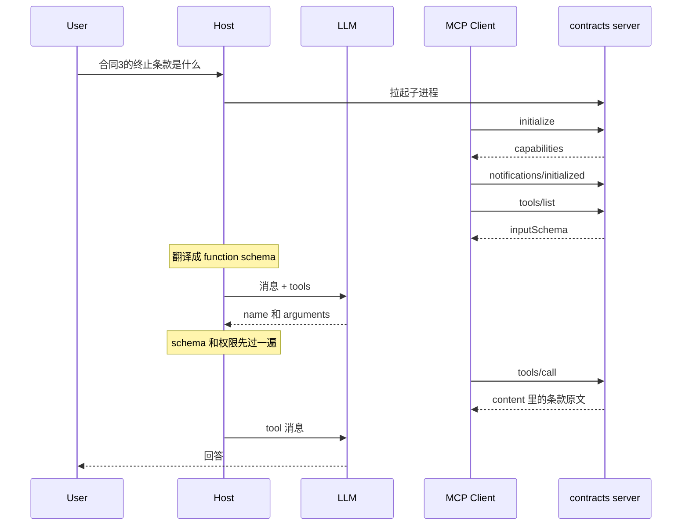

# 腾讯 Agent 开发（校招）面经题汇总

> 按话题归类整理，题目来源：牛客真实面经、2026 校招高频题 PDF、CSDN Agent 工程师 10 问、腾讯云技术实践、《2026年AI Agent研发工程师（校招）高频面试题及解答》100问。标 ★ 为高频必准备。

---

## 一、Agent 核心概念与架构

1. ★ 什么是 AI Agent？它和普通大模型应用有什么区别？（LLM / Tools / Memory / Planning / Execution Loop 五件套）
2. 解释什么是"Agent 应用"？一个面向 C 端的 Agent 应用包括哪些架构模块？（从用户交互 → 任务执行 → 结果输出的完整模块划分）
3. 你觉得当前的 Agent 系统最大的工程挑战是什么？上下文管理？工具调用可靠性？成本控制？评测体系？还是别的？如果有无限资源，你会优先解决哪个？
4. 如何理解 Prompt Engineering → Context Engineering → Harness Engineering 的演进？三者有什么区别？

三者是套在一起的，后面包住前面。演进看的是失败从哪一层冒出来，工作面就扩到哪一层。

Prompt engineering 管这一次调用里的指令：角色、输出格式、正反例、硬规则。合同问答里「每个结论对上 chunk id，对不上就说查不到」是这一层。2023 年前后，改措辞就能修好一批不稳定输出，所以它曾经被当成全部工作。

Context engineering 管这一次调用送进窗口的全部 token。系统约束、工具 schema、改写后的问题、检索到的父段、未完成步骤、最近的工具结果、压缩后的摘要，都算。Karpathy 的说法是：把窗口填上刚好够下一步用的信息。条款原文没送进去，提示词写得再严，模型也只能靠训练数据编。压缩时按规则留下游标和未完成步骤、检索用小块再展开父段、问题放在窗口两头，都是这一层。它在 2025 年被单独拿出来讲，是因为 agent 开始带工具和记忆之后，错答更多来自「看见的东西不对」，而不是措辞。

Harness engineering 管模型以外的运行时。循环、`max_steps`、超时、熔断、工具注册表、MCP client、执行前的参数校验、权限和人工确认、沙箱、session 落盘、做完之后的检查。常见说法是 Agent = Model + Harness。同一模型，换一套停止条件和工具门，任务能不能做完会差很多。模型看不见熔断，也看不见「没过 schema 就不执行」。这些在循环外面。2026 年前后失败又挪了一次：上下文是对的，循环仍会空转、重复调用，或者在没人确认时执行删除。

怎么判断该改哪一层。改一句话能稳住，是 prompt。模型没看见该看的条款、历史或工具结果，是 context。看见了也停不下来、选错工具、或者不该做的做了，是 harness。Harness 里每一轮仍然要组 context，context 里仍然有 prompt。

5. 如果让你设计一个通用 Agent Runtime，要兼容 OpenAI、Anthropic、国产模型等多个厂商的 API，你怎么设计？怎么抽象？

## 二、ReAct / 任务规划与执行循环

6. ★ 什么是 ReAct？Agent 是如何完成循环执行的？（决策 → 行动 → 观察 → 再决策；Agent Loop 伪代码）
7. Agent Loop 中如果工具一直报错、模型陷入死循环，应该如何终止任务？（max_steps、超时、熔断机制）

三层停。`max_steps` 包住整个任务，防止模型换着工具空转。`deadline` 包住墙钟，单次工具调用自己还有超时，超时算一次失败。熔断按工具名记连续失败，到了上限这个工具不再执行。

```text
deadline = now + 60s
max_steps = 8
fail_limit = 3
circuits = {}          # tool name -> {failures, open}

for step in 1 .. max_steps:
    if now > deadline:
        return stopped("timeout")

    response = llm(context)
    if response has no tool calls:
        return response

    if same(tool, args) already ran this task:
        return stopped("repeated call")

    for call in response.tool_calls:
        if circuits[call.name].open:
            context.append("circuit open, do not call " + call.name)
            continue

        result = call_tool(call, timeout=10s)
        if result is error or result timed out:
            circuits[call.name].failures += 1
            if circuits[call.name].failures >= fail_limit:
                circuits[call.name].open = true
            context.append(result)
        else:
            circuits[call.name].failures = 0
            context.append(result)

    if every tool the model needs is open:
        return stopped("circuit open")

return stopped("max steps")
```

没到上限时，失败原文交回模型，它还可以改参数或换工具。到了上限，下次再点这个工具就不执行，上下文里只写「已熔断」。成功一次把该工具的连续失败清零。同一组参数再出现一次，任务停。停的时候返回已经拿到的部分，不要用同一条提示自动再跑一轮大模型。

8. ReAct 是否要求模型公开输出完整推理过程？现代 Agent 有哪些替代做法？（结构化工具调用）
9. Plan-and-Execute 与 ReAct 各适用于什么场景？

ReAct 把「下一步做什么」和「做」放在同一次模型调用里。每看到一条工具结果，模型重新决定下一个工具。计划是一句写在消息里的想法，没有一份先定下来的步骤表。下一步强依赖上一步的观察时用它：先 grep 再决定打开哪个文件，先查到条款再决定要不要第二次检索。短链、分支多、计划写出来也会马上过时。

Plan-and-Execute 先做一次规划，产出一份带状态的步骤表 `{id, text, status}`，执行器按表做。步骤之间的顺序事先看得清、而且希望少调用大模型时用它：五份合同都按同一组四条条款抽证据，计划一次，后面五次只是执行。用户看得见进度，压缩时也能按 `status != done` 留下未完成项。环境一变计划就废的任务不适合。执行中失败了可以单独再规划一次，而不是每一步都重写整份计划。

两者可以套在一起。外面是计划，某个不确定的步骤内部再用 ReAct。区别是控制权：ReAct 每步都问模型「现在做什么」；Plan-and-Execute 先把步骤写成数据，模型主要在执行偏离计划时才被叫回来。

控制权是指下一步的工具和参数由谁填。ReAct 没有表。`search` 返回之后，运行时只能把结果放进上下文，再叫一次模型。模型输出的工具调用就是下一步。grep 到三个文件之后打开哪一个，只有模型知道。

Plan-and-Execute 的下一行已经写着 `search(合同3, "fees")`。运行时按这行调用，不必再问。模型只在两处被叫回来：开头写表，或者某一行失败、表不能再往下走。条款名固定时，表可以由代码填，不必先叫模型。

```text
clauses = ["termination", "fees", "liability", "renewal"]
plan = []
for doc in contracts:
    for clause in clauses:
        plan.append({id, doc, clause, tool: "search", status: "pending"})

for step in plan:
    if step.status == "done":
        continue
    chunks = search(step.doc, step.clause)       # 按表调用，不经模型
    if chunks is error:
        plan = llm_replan(plan, failed=step)     # 只这一次
        continue
    step.quote = pick_span(chunks, step.clause)  # 对得上就用规则
    step.status = "done"

answer = llm_summarize([s for s in plan if s.status == "done"])
```

`pick_span` 对不上原文时，可以只把这一条的块交给模型抽一句话。提示词里没有整份计划，模型不能改下一步。最后一次 `llm_summarize` 看见的是已经写好的摘录。

Claude 现在日常用的是 ReAct 这一侧。模型返回文字或工具调用，Claude Code 执行，把结果送回，模型再决定，直到可验证的停止条件。Anthropic 在 [Building effective agents](https://www.anthropic.com/research/building-effective-agents) 里写的也是：生产里的 agent 通常就是模型根据环境反馈在循环里用工具。

[Plan mode](https://code.claude.com/docs/en/best-practices) 没有换成另一套执行器。`Shift+Tab` 之后模型仍能读文件、跑命令，只是不能改文件。计划被批准之后，同一个循环才开始改代码，每一步还是模型选。计划是给人看的上下文，不是运行时逐行执行的程序。走偏了，官方建议切回 plan mode 重写，而不是在半路硬改。

更接近 Plan-and-Execute 的是 [dynamic workflows](https://code.claude.com/docs/en/workflows)。Claude 写一段脚本，运行时执行脚本。脚本决定下一步叫哪个子 agent，中间结果放在脚本变量里。文档里的对照是：子 agent 由 Claude 一轮一轮决定；workflow 由脚本决定。他们把这套留给几百个文件的迁移这类可重复任务，并写明普通写代码不要上，token 会多很多。默认仍是把控制权留给模型。

## 三、Function Calling / Tool Calling / MCP

10. ★ Function Calling、Tool Calling 和 MCP 有什么区别？（机制 vs 协议；MCP Server / Client / Tools / Resources / Prompts 的关系）

三件东西不在一层。Function Calling 是模型侧的机制，Tool Calling 是宿主把这次输出执行掉的那一轮，MCP 是宿主和工具进程之间的协议。模型不说 MCP。

Function Calling：请求里带一份 JSON schema，含名字、描述、参数。模型不执行函数，只输出 `name` 和 `arguments`。OpenAI 现在的字段叫 `tools`，早期叫 `functions`，吐出结构化调用这件事是同一个机制。

Tool Calling：宿主解析这次输出，按名字找到处理函数，执行，把结果写成 tool 消息，再叫模型。循环里的「做」在这一层。名字不在注册表里、参数不合法，都在这一层拦住，不把编造的结果交回模型。

MCP：宿主里的 client 和一个 server 做 JSON-RPC。默认走 stdio，远程用 Streamable HTTP。握手是 `initialize`，然后 `tools/list` 拿到 `{name, description, inputSchema}`，宿主把它翻译成上面那份 function schema。模型吐出调用之后，client 发 `tools/call`。Server 是一个进程，不是模型。

一个 server 上有三类东西：

- Tools：模型可以发起的动作，可以有副作用，走 `tools/call`。
- Resources：只读数据，文件、工单。宿主用 `resources/read` 取，通常由应用决定读哪一个。
- Prompts：现成的提示词模板，`prompts/get`。给人挑，或给宿主拼进上下文，不是一次执行。

和 A2A 分开。MCP 是 agent 对工具。A2A 是 agent 对另一个 agent。

Function Calling 和 Tool Calling 用同一次「查合同」就能分开。用户说「合同 3 的终止条款是什么」。请求里除了这句话，还有一张工具表：

```json
{"tools":[{"type":"function","function":{"name":"search_contracts","description":"按合同号和条款名检索原文","parameters":{"type":"object","properties":{"doc":{"type":"string"},"clause":{"type":"string","enum":["termination","fees","liability","renewal"]}},"required":["doc","clause"]}}}]}
```

模型这一轮吐出的是填好的表，数据库还没动：

```json
{"name":"search_contracts","arguments":{"doc":"合同3","clause":"termination"}}
```

这一跳是 Function Calling。没有这张表，模型只会写「我去查一下」，宿主得从句子里猜。Tool Calling 是宿主接着做的事：按名字执行 `search_contracts("合同3","termination")`，把条款原文写成 tool 消息，再叫一次模型，模型才写给人看的回答。

MCP 插在「宿主执行」这一跳的外面，模型仍然只填表。四个人各管一件事：宿主是 agent 循环，管对话、权限、拉起哪些 server；MCP client 住在宿主里，一个 server 一条会话；MCP server 是另一个进程，它才去查库；模型只看见翻译好的 function schema。

本地默认把 server 当子进程拉起来，JSON-RPC 一行一条，写进 stdin，从 stdout 读回来。远程不拉进程，client 把同一条 JSON-RPC POST 到一个 HTTP 端点，这就是 Streamable HTTP。



握手只发生一次。`initialize` 里双方报 `protocolVersion`，对不上就停。接着一条没有 `id` 的通知 `notifications/initialized`。然后 `tools/list`。server 返回的字段叫 `inputSchema`，宿主把它改名放进 `parameters`。之后每轮提问都带这份 schema，不必每次再 `tools/list`；server 通知工具表变了再拉一次。

模型填完表之后，宿主先验参、看权限，client 才发：

```json
{"jsonrpc":"2.0","id":3,"method":"tools/call","params":{"name":"search_contracts","arguments":{"doc":"合同3","clause":"termination"}}}
```

server 用 `content` 把原文送回来。业务失败时 RPC 仍然成功，`isError: true`，错误文本放进 `content`，模型下一轮读得到。JSON 不合法、没有这个方法，才是 JSON-RPC 错误，到不了模型。两个 server 都有一个叫 `search` 的工具时，宿主翻译时给名字加上 server 前缀。

Server 收到的是 client 的 `tools/call`，沿这条管道再把 `content` 送回宿主。宿主写成 tool 消息，模型才能看见结果。高德这种外部服务上，server 自己再当 HTTP 客户端去调高德的开放接口。

Server 从哪来：服务方发布，agent 不把地图 SDK 写进自己的进程。高德现在有两种接法（文档更新到 2026-03）。远程推荐 Streamable HTTP，宿主只配一条 URL，本机没有 server 进程：

```json
{"mcpServers":{"amap-maps-streamableHTTP":{"url":"https://mcp.amap.com/mcp?key=你的key"}}}
```

本地则是高德发布的 npm 包，宿主用 `npx` 把它拉成子进程，key 放在环境变量里：

```json
{"mcpServers":{"amap-maps":{"command":"npx","args":["-y","@amap/amap-maps-mcp-server"],"env":{"AMAP_MAPS_API_KEY":"你的key"}}}}
```

这个包就是 server，语言是 JavaScript。`npx` 是 Node 自带的运行器，`-y` 表示下载后直接跑。agent 可以是 Python，它只拉起这个进程，两边用 JSON-RPC 说话。选 Node 是为了分发：一条命令就能把适配器下载并启动。同一件事用 Python 的 `uvx` 也能做。一个高德 server 上挂着多个 tool：`maps_geo`、`maps_weather`、`maps_direction_driving`、关键词搜索。再接 GitHub，才是第二个 server。宿主里一条连接一个 MCP client，所以这也是第二个 client。

高德这把 key 是 API key，谁复制了谁就能调。远程 URL 把它放在 query 里，配置文件、截图、代理日志都会带走。本地进程从环境变量读 key，再由这个进程去调高德的 HTTP。key 还是会发到高德，只是不写进你拿去分享的 MCP 地址。

AK/SK 比一把 API key 更严格，SK 不能出现在 URL 里。线上只带 AccessKeyId、时间、随机串和签名。SDK 在本地用 SK 做 HMAC，服务端按 AccessKeyId 查出同一把 SK，把签名重算一遍。对得上、时间窗里、随机串没用过，请求才成立。本地没有一步「先验证通过再签名」。签名就是证明，验证在服务端。`ensure_valid` 只检查环境变量在不在。

阿里云现在的算法是 `ACS3-HMAC-SHA256`。SDK 把方法、路径、query、参与签名的头、body 的哈希拼成规范串，再 `HMAC-SHA256(SK, 规范串的哈希)`。`Authorization` 里是 `Credential=AccessKeyId` 和 `Signature=...`。有 STS 临时凭证时，临时 SK 用来签，`security_token` 放进 `x-acs-security-token`。长期 SK 可以只留在换票那一步，甚至留在 RAM 角色里，不进这台机器。

Deploy 工具里这两层都有，代码在 `modelstudio_deployer.py`。`from_env` 读 `ALIBABA_CLOUD_ACCESS_KEY_ID`、`ALIBABA_CLOUD_ACCESS_KEY_SECRET`，可选 `ALIBABA_CLOUD_SECURITY_TOKEN`，放进 `open_api_models.Config`，再建百炼的 `ModelstudioClient`。HMAC 写在 `alibabacloud_tea_openapi` 里，deploy 工具自己没有签名函数。它做的是：

1. 读凭证，拼业务参数。`ApplyTempStorageLease` 带文件名和字节数。
2. 官方 SDK 签完发出去。SK 留在进程里。
3. 百炼返回 `Param.Url` 和 `Param.Headers`。这是预签名 PUT，平台用自己的密钥签的，限制了对象和过期时间。`requests.put` 把 wheel 传上去，这次请求里没有 SK。
4. `HighCodeDeploy` 再走一次同样的 AK/SK 签名。body 里是 lease id、agent 名、agent id，没有 SK。

一份云 SDK 一般就这几块：从环境变量、配置文件或 STS 读密钥；把参数收成请求对象；规范化并 HMAC；发 HTTP、重试、把 `NoPermission` 翻成人能读的错误；有时再消费服务端签发的窄授权，比如这个预签名 URL。业务代码通常只碰到前两块和最后一块。

11. 什么场景直接写 Function Calling，什么场景用 MCP？

看这份 schema 的主人是谁。

主人是这个 agent 自己的代码，就直接注册 function。`search`、`execute_python` 这种，schema 和处理函数写在一起，循环按名字分发。再套一个 MCP 进程，只是多一次序列化和一个要管的生命周期。

主人是外部服务，而且希望换宿主不用重写，就用 MCP。GitHub、文件系统、Slack：实现一次 server，Cursor、Claude Desktop、自己的 runtime 都用同一套 `tools/list` / `tools/call`。这边只写 client 和权限门，不给每个框架写一个适配器。

同一个工具可以两边都有。进程内一份给单测和这条循环用，对外再包一层 MCP server 给别的宿主挂。

12. MCP 解决了什么问题？它能保证工具调用安全吗？所有模型都原生支持 MCP 吗？

它解决的是 M×N。每接一个数据源，每个 agent 框架都写一个适配器，工具数乘框架数。MCP 把发现和调用收成一套 JSON-RPC。工具方实现一次，任何听得懂的宿主都能挂上。

它不保证安全。协议只规定怎么列、怎么调，不规定这次调用该不该发生。安全在宿主：服务器白名单、每个工具的权限、删除和发送进人工确认、参数校验、文件系统进目录沙箱。Server 是独立进程，只是弱隔离。把生产库的 server 挂进任意对话，协议拦不住。

模型也不原生支持 MCP。原生的是 function schema。宿主把 `tools/list` 翻译成那份 schema，模型按 schema 吐 JSON。不支持结构化工具调用的模型，只能在提示词里约定文本格式再解析。MCP 仍能接上，选工具和填参会差一截。

13. 如何设计一个好的工具描述（tool description）？工具选错一般先优化 Prompt、工具描述、工具路由，还是换模型？（思考题）

描述要让模型分得清什么时候用、什么时候别用。

名字用动词加对象，和别的工具不重叠。`search_contracts` 和 `grep_repo` 不要都叫 search。描述写触发条件、不该用的情况、返回的是什么，一两句，不写实现。参数少，只有必填的才放进 required。每个字段写类型、枚举和格式，日期是 `YYYY-MM-DD`，id 是合同号而不是文件路径。一个工具做一件事，又搜又改的拆开。两个容易混的工具，在描述里互相点名。

选错了，先改描述和路由，最后才换模型。工具太多或名字撞车，先收到三五个候选再交给模型。然后改 description 和参数 schema，这是最便宜、也最常有效的一档。再改系统提示里的选用规则，配一正一反的例子。描述已经分得清、换一个更强的模型仍然选错，才换模型。换模型修不了一份含糊的 schema。

14. 工具参数校验应该在哪一层做？为什么不能只靠模型？

在宿主执行之前。模型输出只是一份不可信的 JSON。

先过 schema。名字必须在注册表里，参数过 JSON schema：类型、必填、枚举、长度，多余字段拒绝。不过就不调用函数，把校验错误当成工具结果送回，让模型改一次。

再过业务和权限。schema 合法不等于能做。`tenant_id` 从登录态取，不从参数信。路径必须落在允许的目录里。删除、发送、部署再加人工确认。金额和条数有上限。

只靠模型会漏，是因为它会编出不存在的字段，也会把用户的一句话填成越权参数。Schema 写进提示词只提高填对的概率，拦不住一次错误输出。MCP 的 `inputSchema` 同样在宿主验完再发 `tools/call`，未校验的 arguments 不原样转发。

## 四、记忆与上下文管理

设计和 `RAG&Memory/rag&memory_system.md` 是同一套。口述用下面三层的名字：短期上下文、持久化任务状态、长期记忆。笔记里的 working / session / long-term 分别对应这三层。KV cache 不是记忆，请求结束就没了。

15. ★ Agent 的 Memory 应该如何设计？（短期上下文 / 持久化任务状态 / 长期记忆三层）

三层，循环本身不「跑记忆」。记忆是调用模型前读进上下文、调用之后写回去的状态。

- 短期上下文是这一轮真正送给模型的消息列表：用户这句话、模型的工具调用、工具结果。它在进程里。循环结束，这个对象就没了。规划也写在这里，待办清单是一条 assistant 消息，下一步能看见它，是因为它在列表里。
- 持久化任务状态是这份对话和这个任务的进度，落在磁盘上。每条消息追加进 session（JSONL、SQLite 或 Postgres），键是 `session_id`。长任务另有一个游标：做到第几个文件、哪些已完成、哪些失败。进程重启后先读这份状态，再把它装进新的短期上下文。
- 长期记忆跨会话。用户偏好、抽出来的事实、检索到的文档块。按 `user_id` 存进画像表或向量索引，用到才取几条注入提示词，不把整库重放进窗口。

Pi 只有前两层。`currentContext.messages` 是短期列表，`AgentSession` 把每条消息追加进 session 树。跨会话只有人手写的 `AGENTS.md`。用户画像是插件在 `context` 事件里注入的，运行时自己不存。

16. ★ 当对话历史过长超出上下文窗口，有哪些工程处理方案？（滑动窗口硬截断 / 摘要压缩 / 向量库长期记忆——只答滑动窗口显得初级）

三档，按丢掉的东西从多到少说，不要只答滑动窗口。

- 滑动窗口：从最老的消息砍。实现就是列表切片。闲聊够用。任务型对话会把最早的目标和约束砍掉，所以它只是兜底，不是方案本身。
- 摘要压缩：窗口满了，在下一轮模型调用之前，把前缀交给一次摘要调用，工作记忆换成「摘要 + 最近几轮原文」。Pi 的钩子叫 `prepareNextTurn`。摘要旁边附一份从工具调用里解析出来的文件清单（读过哪些、改过哪些），这份清单不让模型回忆。原始条目仍留在 session 树上，下次加载从摘要这条往下走。
- 长期记忆改走检索：必须跨会话留下来的事实写进向量库或画像表，下次按当前问题取回。这解决的是「以后还用得上」，不是「这一轮窗口满了」。当前这轮的工具结果仍然要留在短期上下文里。

同时少送 RAG：低分 chunk 先丢，8 段收到 4 段。系统约束和当前问题最后砍。

17. 如果让你设计上下文压缩方案，你会保留哪些信息？丢弃哪些？

按「丢了会做错」留。

留下：系统约束（必须引用、不能越权、输出格式）、当前用户目标、还没做完的计划、下一步要用的最近一次工具结果、正在引用的 chunk id 和原文、任务游标（下一份是第 81 个文件）。文件清单从工具调用解析，不从摘要散文里抽。

丢掉：已经写进摘要的旧对话原文、成功之后的大段工具输出、低分 chunk、重复的工具调用、产品不展示的推理痕迹。

不丢引用规则，也不把游标只写在摘要句子里。摘要可以错，游标和文件清单必须能对上日志。

「还没做完的计划」不是一份必须存在的 todo list。有计划才留，没有就没有这一项。它指上下文里已经写下来、还没做完的步骤，来源有两个。一个是模型写进消息的计划，比如 ReAct 的 thought，或 plan-and-execute 先产出的步骤；压缩时只留未完成的几条。另一个是任务游标本身：100 个文件做到 80，剩下的就是从第 81 个继续。游标是结构化的「还没做完」，比散文里的清单更该留。文件清单是另一样东西，记录已经读过、改过哪些文件，用来核对摘要，不是待办。

识别不靠模型。压缩器只认消息的类型和字段。计划如果只写在散文里，规则看不见哪几步还没做，所以计划不要放在散文里。模型唯一该做的是把旧的用户和助手原文收成一段摘要。系统约束、游标、未完成步骤、文件清单、最近一次工具结果都按规则原样留下，不送进这次摘要调用。

计划在写入时就是结构化的。循环里给一个 `todo_write` 工具，参数是 `{id, text, status}`。压缩时扫描工具调用，留下 `status != done` 的条目。游标本来就是检查点里的一个数字，整行保留。文件清单按工具名解析：`read_file` 和 `write_file` 的路径参数。最近一次工具结果按规则取，比如每个未完成步骤的最后一条。成功的旧输出丢掉，报错的留下。

```text
keep = [system 消息]
keep += checkpoint                          # 游标，原样
keep += [step for step in todo if step.status != "done"]
keep += parse_file_ops(tool_calls)          # 只看工具名和参数
keep += last_tool_result(open_steps)
keep += 最近两轮原文
summary = llm(更早的用户和助手正文)          # 工具输出和系统提示不放进去
context = keep + summary
```

Pi 自己没有 todo 工具。助手消息里的「下一步是……」压缩器不会单独挑出来。要这条规则，就在扩展里把计划写成一条带类型的记录，压缩时按类型过滤。

18. 长期记忆和短期记忆分别怎么实现？存什么、存在哪？

短期分两截。进程里是消息数组，一次模型调用读它。磁盘上是 session 表，每条记录 `session_id`、`parent_id`、角色、内容和时间。存用户消息、模型消息、工具名和参数、工具结果。下一轮 `load(session_id)` 装回数组。超窗口时写一条 compaction 记录：摘要、保留的尾部、文件清单。

长期是另一张表，不跟会话日志混。结构化偏好（尺码、价位、语言）放画像行，更新是覆盖字段。事实放向量索引：正文、embedding、`user_id`、来源、时间、置信度。线上只做嵌入当前问题、取回 top-k、注入提示词。一份特别长的材料用 MemAgent 的方式：分段读，覆写一块固定长度的记忆，而不是把全文塞进窗口。行为序列（点击、购买）是特征管道，近实时算好，请求时取，不放进对话日志。

19. 记忆的过期、更新、删除机制怎么做？多用户之间如何做数据隔离？

过期看层。会话的热缓存可以设 TTL，审计日志留得比注入窗口久。事实带 `valid_until`，检索时按时间和重要性衰减，旧的仍在库里，只是排不进 top-k。

更新不原地改一句散文。画像字段直接覆盖。事实追加新版本，旧版本标 superseded，检索只取最新。两条矛盾的事实不要默默合成一句。

删除是墓碑。用户说忘掉，写一条 tombstone，检索时滤掉。只删向量行不够：session 原文里还有，压缩或导出时也要认这张墓碑。压缩本身不删除旧条目，它是多写一条摘要。

隔离发生在检索之前。每行有 `user_id` 和 `tenant_id`，从登录态取，不信请求体里的 id。模型看到的文本已经滤过。共享索引加过滤是起步；合规要求物理隔离时，按租户拆索引和对象存储。用户 B 的块不能出现在用户 A 的提示词里。

20. 长任务断点恢复怎么做？（任务 ID、检查点、状态持久化；如处理 100 个文件到第 80 个服务重启）

进度不放在进程里的消息数组上。任务有 `task_id`。每处理完一个文件就提交检查点：`{task_id, cursor: 80, completed_ids, failed_ids}`。写文件用幂等键，先落结果，再推进游标。崩在这两步之间，重启后第 80 个文件再写一次也是同一次写。

重启只做三件事：用 `task_id` 读检查点，跳过已完成的，从第 81 个继续。不要把前 80 次工具结果重放进窗口。短期上下文重建为「系统约束 + 一句进度摘要 + 游标」，session 里留着完整日志供追查。

Pi 的做法是每条消息追加进 session，所以日志还在，但 100 个文件仍要单独的游标，否则窗口会满。LangGraph 是每步一个检查点（通道的值、版本、每个节点见过的版本），下一步 `plan()` 从这份检查点接着跑。两种都是「步骤已经结束才能恢复」，停在函数半中间的循环带不走。

---

## 五、RAG 与知识检索

21. ★ 什么是 RAG？它在企业级 Agent 开发中主要解决什么核心痛点？（幻觉 / 私有数据隔离 / 知识时效性；强调是"外部挂载"不是微调）
22. ★ RAG 和 Agent 有什么区别？什么时候应该结合使用？（Agentic RAG：Agent 自主决定是否检索、检索什么）
23. 向量嵌入（Embedding）在构建知识库时起什么作用？（语义 → 高维坐标；余弦相似度检索）
24. 文档切分（chunking）有哪些策略？chunk 大小如何权衡？

切的是解析后的正文，不是 PDF 字节，也不是解析器吐出的 JSON。长度用字符数，或者用分词器数 token。嵌入模型还没跑，切块不需要向量。

常用的是递归字符切分：先在空行切，再在换行切，再在空格切，装到固定长度就停，相邻块重叠大约 10%–20%。它不认识标题。固定长度切分更粗，数到 N 个字符就砍，会从词中间断开。按句子切分不填长度预算，一句就是一块，检索命中后再把前后句送给模型。语义切分先给每句嵌一个向量，相似度掉下来就新开一块，入库时多一次嵌入。模型切分让大模型决定边界，最贵。

有标题的 PDF 用结构化切分。标题本身不单独成块，「4. Termination」嵌出来能匹配问题，但里面没有答案。标题开启一节，后面的段落都属于它，直到同级或更高级的下一个标题。这一节在 300–800 token 以内，标题和正文是一块，标题也写在嵌入文本的开头。超过上限，只在这一节内部做递归切分，每一片都带上同一个标题。没有正文的标题并进下一节。表格保持一整块，把 `| Seat |` 和 `$40 / month` 切开，两边都不再表示价格。

检索用小块，因为它的向量只代表一件事。送给模型的是父段，整节「4. Termination」，否则答案会漏掉同一节里的例外。整本手册嵌成一个向量，终止条款和费用被平均成一个点，近邻搜不到。切得比一句话还碎，问题跟哪一半都不像。

25. 混合检索（向量 + BM25/关键词）怎么做？Rerank 在 RAG 链路中的位置和作用？

两路都只返回 `chunk_id`。向量路把问题嵌成一个向量，在 HNSW 上按距离取近邻，负责「结束合同」对上「terminate」。关键词路是倒排索引上的 BM25，负责条款号、SKU、「第12条」。BM25 不是 grep。grep 只说字符串在不在。BM25 给每块打分：稀有词比常见词值钱；同一个词出现第十次，加分少于第一次，避免堆词；块的长度相对平均长度做归一，长段落不会只因为长而赢。两路的原始分数不能相加，量纲不同。融合只用名次，倒数排名：一块在一份名单里排第 r 名，就加上 `1 / (60 + r)`。两份名单都排第 2（各 `1/62`，合计约 0.032）高于只在一份名单里排第 1（`1/61`，约 0.016）。

Rerank 在融合之后、生成之前。只对融合得到的前 20–50 个 id 做。交叉编码器把问题和这一块拼成一条序列，`[CLS]` 由分词器插在最前面，不来自原文。注意力让问题里的词看见块里的词，分类头读 `[CLS]` 位置的向量，输出一个相关分数，不是余弦。按这个分数留下 4–8 块。它能把「费用表」从「终止条款」后面挪走。第一阶段没召回的块，它看不见。关键词已经精确命中时可以跳过。延迟或 GPU 紧的时候，它是最先关掉的那一档，大约 50–150 ms。

26. 引用溯源怎么做？如何评估检索质量？（召回率、MRR、nDCG）

每个送进提示词的块带上 `chunk_id`、页码和标题路径。模型的每句结论必须点名其中一个 id，并且引号里的原文要真的出现在那一块里。点了没检索到的 id，或者引文对不上，这条结论不展示，改成「无法确认」。权限过滤发生在取正文之前，引用里不会出现用户不能看的块。

检索和生成分开量。先有标注：一个问题对应应该命中的 `chunk_id` 或页码。没有这份标注，召回率算不出来。Recall@k 是金标里有多少落在前 k 名。Hit Rate 是前 k 里有没有至少中一个。MRR 看第一个命中排第几，排第一是 1，排第二是 1/2。nDCG 把名次换成折扣，排得靠前的命中更值钱，并且能处理一份金标里有多块。上线门槛用 Recall@k，长合同和 FAQ 分开看。

忠实度、引用是否支持这句话，量的是生成。检索对了、模型不用这段，忠实度会失败。回答好看、金标块根本不在前 k，Recall@k 会失败。两个数不能互相代替。Rerank 只重排前 50，所以第一阶段的 Recall@50 仍然是系统的上限。

27. GraphRAG 解决普通 RAG 的什么局限？（长上下文、实体关系推理）

普通 RAG 一次只拿回和问题最像的几块。一块里能写完的事实，这样够用。「终止要提前 30 天」就在 `c-term` 里。它不够的是两种问题。

一种要跨块推理。甲公司和乙公司签约写在一块，乙公司被丙公司收购写在另一块。问题「谁现在控制甲的合同」和其中任何一块都不像，向量近邻两块都排不进前 k。图在入库时把实体和关系抽出来：甲—签约—乙，乙—被收购—丙。检索先落到实体，再沿边走到另一块。这是实体关系，不是把窗口变长。

另一种要看完整料库。「这些合同里终止条款有哪些共同模式」的答案散在几百块里，塞进一次提示词会超出窗口。GraphRAG 在入库时对图做社区划分，由下往上为每个社区写摘要。提问时对社区摘要做 map-reduce，而不是把几百块原文放进上下文。长上下文的问题被提前算成短摘要，窗口本身没有变大。

点查仍然走向量加 BM25。抽实体是每个块一次模型调用，图抽错了，后面的推理就跟着错。30 天这种问题不值得建图。

28. 企业 RAG 落地中，知识准备环节最容易踩的坑是什么？（文档解析质量、切分方式）

坑在入库，不在线上那一次检索。嵌入模型只能看见解析器吐出的字。扫描件没有文字层却没走 OCR，或者 PDF 缺 ToUnicode，中文会变成乱码，乱码会被认真地嵌进索引。双栏如果按从左到右连成一行，左栏第一行会粘上右栏第一行，这块以后哪边的问题都搜不中。表格如果压成一句话，「Seat」和「$40」不再同行。这些块状态仍可能被标成 READY。解析失败的文件应该是 FAILED，不能被搜到。

切分是第二坑。整篇嵌成一个向量，近邻找不到条款。固定长度从句子中间砍开，问题跟哪一半都不像。标题单独成块，能匹配「终止」但没有答案。标题路径和页码没有抄到块上，后面无法引用，也无法按「2024 合同」过滤。

还有两件同属准备、线上补不回来的事。权限要在切块时抄到块上，取正文之前过滤。只在生成之后检查，提示词里已经漏了。同一份文件用 `document_id` 加校验和做幂等。更新时删掉旧块再写新块，否则新旧两版一起被搜出来。换嵌入模型必须重建索引，旧向量和新问题的向量不在一个空间里。

## 六、Prompt 工程

29. System Prompt 一般包含哪些部分？（角色、任务、约束、输入输出格式、示例）
30. Few-shot / Chain-of-Thought 各解决什么问题？CoT 有哪些变体？
31. 如何让模型稳定输出结构化 JSON？（约束解码、schema、重试校验）
32. Prompt 注入（Prompt Injection）有哪些形式？如何防御？（不可信内容隔离、指令优先级）
33. Prompt 版本管理怎么做？Prompt 改动如何做回归测试？

## 七、多智能体（Multi-Agent）系统

34. ★ 单 Agent 和 Multi-Agent 如何选择？（拆分的前提是"拆开有明确收益"，不是"能拆"）
35. 常见的多 Agent 编排模式有哪些？（Supervisor / Handoff / Parallel / Evaluator-Generator）
36. ★ 多智能体协同中，如何解决互相复读或"死循环"对话？（角色边界 Prompt 隔离 / 中央路由或 SOP / 工程熔断：最大轮次、相似度检测）
37. 请简述斯坦福"AI 小镇"（Generative Agents）论文在多智能体交互方面的核心贡献。（25 智能体；记忆流：观察 / 检索 / 反思 / 规划；涌现）
38. 多 Agent 的上下文传递、状态一致性、错误传播问题怎么处理？

## 八、Workflow vs Agent 选型

39. ★ Workflow 和 Agent 有什么区别？什么场景不应该用 Agent？（控制权在程序还是模型；确定性流程用 Workflow）
40. "确定性流程交给 Workflow，不确定性决策交给 Agent"——举例说明如何在一个系统中结合两者。

## 九、Agent 评测（Evals）与可观测性

41. ★ 如何评估一个 Agent 的效果？除了回答正确率还看什么？（任务成功率 / 工具调用准确率 / 延迟 P95·P99 / Token 成本 / 错误恢复率 / 安全违规率）
42. 如何建立 Agent 的回归测试体系？（固定测试集、轨迹追踪、模型/Prompt 变更的影响评估）
43. 线上如何监控 Agent？（调用链追踪 Tracing、Token 消耗、工具耗时、失败原因、任务完成率）

## 十、Agent 安全与风险控制

44. ★ Agent 为什么容易失控？如何保证工具调用安全？（Prompt 注入 / 权限过大 / 参数未校验 / 缺人工确认；最小权限、服务端校验、安全边界在模型之外）
45. 如果 Agent 需要生成代码并在沙箱里执行，怎么设计安全的沙箱环境？必须考虑哪些安全风险？（隔离、资源限制、网络控制、超时熔断）
46. 高风险操作（转账、删数据、发邮件）如何做人工审批？审批流怎么设计不阻塞体验？

## 十一、成本与性能优化

47. ★ 相比单次大模型对话，Agent 响应延迟高的时间开销主要在哪些环节？（多轮 LLM 往返 / 工具调用 I/O 阻塞 / 多 Agent 通信同步）
48. ★ Agent 在 C 端大规模部署时 Token 成本很高，怎么控制？（小模型分流、缓存、并行、 prompt 瘦身、按任务复杂度选模型）
49. 首字延迟（TTFT）对 Agent 体验的影响？流式输出在 Agent 场景下怎么做？

## 十二、生产级 Agent 系统设计（综合题）

50. ★ 如果让你从零设计一个生产级 Agent 系统（企业内部 AI 助手：知识库查询 + 数据分析 + 报告生成 + 文件操作），你会怎么做？（Agent 执行层 / 工具·MCP 层 / 状态存储 / 异步任务 / 安全 / 可观测 / 成本；失败场景与幂等性）
51. 长耗时任务怎么做异步化？（消息队列、任务 ID 轮询、回调）
52. 有副作用的操作如何保证幂等？（任务重试不重复扣费/重复发送）

## 十三、大模型基础：Transformer 与注意力机制

53. ★ Self-Attention 的计算公式？Q、K、V 各自的作用？为什么要除以 √d_k？
54. ★ 为什么需要位置编码？Self-Attention 的置换不变性是什么意思？（"我爱你" vs "你爱我"）
55. 绝对位置编码 vs 相对位置编码 vs RoPE，各自原理和优缺点？
56. Multi-Head Attention 为什么要用多头？头数增加是否等于能力翻倍？
57. Decoder-only / Encoder-only / Encoder-Decoder 架构的区别？为什么现在大模型主流是 Decoder-only？
58. KV Cache 的原理？它解决什么问题，带来什么代价？（显存占用）
59. GQA / MQA 是什么？为了解决什么问题？
60. LayerNorm vs RMSNorm？Pre-Norm vs Post-Norm 的区别？
61. SwiGLU / GELU 激活函数了解吗？FFN 在 Transformer 中的作用？

## 十四、大模型基础：解码与推理

62. ★ Temperature、Top-p、Top-k 各自控制什么？怎么调？
63. Greedy / Beam Search / 采样解码的区别和适用场景？
64. 什么是幻觉（Hallucination）？从模型原理上解释成因，有哪些缓解手段？
65. 上下文窗口（Context Window）是什么限制的？长上下文模型做了哪些改进？
66. Tokenizer（BPE）的基本原理？中文分词对 Token 消耗的影响？

## 十五、模型训练与微调

67. 预训练（Pretrain）/ SFT / RLHF 各自解决什么问题？三阶段的关系？
68. ★ LoRA 的原理？为什么只训练低秩矩阵就能work？（W = W0 + BA）
69. DPO 与 PPO/RLHF 的区别？各有什么优缺点？
70. 指令微调的数据一般怎么构造？（指令-输入-输出三元组）
71. 模型评测常用 Benchmark 有哪些？（MMLU、HumanEval、GSM8K 等，知道考察维度即可）
72. 过拟合在微调场景下怎么发现、怎么处理？

## 十六、Python 与工程基础

73. ★ Python 的 GIL 是什么？对多线程的影响？Agent 并发场景下怎么绕开？（多进程 / 异步 IO）
74. asyncio 的原理？async/await 在 Agent 工具并发调用中的使用？
75. 深拷贝 vs 浅拷贝？可变对象作为默认参数的坑？
76. 生成器（generator）/ 迭代器？大文件/大数据流处理为什么用它？
77. Python 如何做 HTTP 并发请求？（aiohttp、连接池、限流）
78. 异常处理：Agent 工具调用失败时的重试策略？（指数退避、熔断）
79. 熟悉 LangChain / LangGraph / LlamaIndex / AutoGen 中的哪几个？说说用过的组件和踩过的坑。
80. Redis 在 Agent 系统里一般存什么？（会话、任务状态、缓存、分布式锁、限流计数）
81. 消息队列（Kafka/RabbitMQ）在 Agent 异步任务中的作用？

## 十七、算法与数据结构（手撕代码高频）

82. 反转链表（单链表 / K 个一组反转）
83. 二叉树层序遍历 / 之字形遍历 / 最近公共祖先（LCA）
84. 滑动窗口：无重复字符的最长子串 / 最小覆盖子串
85. 动态规划：最长递增子序列 / 爬楼梯 / 零钱兑换
86. Top K 问题：前 K 个高频元素（堆）
87. 合并区间 / 会议室安排
88. LRU 缓存设计（哈希表 + 双向链表）
89. 字符串解码（如 "3[a2[c]]" 展开——Agent 评估/沙箱题也常考这类解析题）
90. 括号生成 / 全排列 / 子集（回溯模板）

## 十八、项目深挖（简历必问）

91. 介绍一个你最有代表性的 Agent/大模型项目：背景、架构、你的职责、技术选型理由。
92. 项目中最难的技术点是什么？怎么解决的？（追问细节：为什么不用 X 方案？）
93. 你的 Agent 在真实场景下效果如何？怎么量化的？（成功率、延迟、成本数据）
94. 如果重来一次，你会怎么改进这个项目？
95. 多人协作的项目中，你负责哪部分？如何与他人接口对接？

## 十九、开放性 / 场景题

96. 给微信/王者荣耀设计一个 Agent 功能，你会怎么做？（腾讯特色：结合业务场景）
97. 如何用 Agent 提升腾讯内部某个业务的效率？（考察业务理解 + 技术方案）
98. 如果模型 API 突然限流/降级，你的 Agent 系统如何优雅降级？
99. 用户对 Agent 结果不满意，如何设计反馈闭环持续优化？（RLHF /  badcase 收集 / 评测集沉淀）

## 二十、行为面 / HR 面

100. 为什么选择腾讯？为什么做 Agent 方向？
101. 遇到过最有挑战的项目经历？如何推动解决的？
102. 如何学习新技术？最近在关注 Agent 领域的哪些进展？（如 MCP、Agent Runtime、RL 新范式）
103. 能接受加班/业务压力吗？对工作地点的看法？
104. 反问环节可以问什么？（团队业务、Agent 落地场景、技术栈、培养机制）

---

### 备考建议

- **校招 Agent 岗 = 60% Agent 工程 + 25% LLM 基础 + 15% 算法手撕**：先把一～十二章吃透，这是和纯后端/算法岗最大的区别。
- ★ 题至少要能讲出"是什么、为什么、怎么权衡"，不要只背定义——面试官最爱追问"为什么不用 X"。
- 准备 1～2 个能讲 10 分钟的 Agent 项目，数据（成功率/延迟/成本）能量化就量化。
- 腾讯系（混元/腾讯云/IEG/WXG）都看重**业务结合**：准备一道"给某业务设计 Agent"的场景题。

---

## 附：校招高频 100 问补充（按原 PDF 六大模块）

> 以下题目来自《2026年AI Agent研发工程师（校招）高频面试题及解答》，与正文重复的不再收录，只收新增。★ 数量为原文档标注的考察频率。

### A. 大模型与 Agent 基础理论（新增）

1. ★★★★★ 请简述你对 AI Agent 的理解，它与传统的 RPA 有什么本质区别？（预设规则 vs 动态推理；结构化 vs 非结构化环境）
2. ★★★★★ 大语言模型（LLM）在 AI Agent 系统中扮演什么样的核心角色？（"中央处理器"：意图理解、任务拆解、工具选择）
3. ★★★★★ 业界常说 Agent 核心架构是"感知、大脑、执行"，分别解释三个模块的作用。（讲清模块间数据流）
4. ★★★★★ AutoGPT 和 BabyAGI 等早期开源智能体项目的核心技术创新点是什么？（自主目标拆解+记忆+工具循环；也要指出落地问题）
5. ★★★★★ 主流 Agent 框架有哪些（LangChain、AutoGen、MetaGPT），各自定位和特点？（没用过的要诚实，别报菜名）
6. ★★★★★ 什么是 Agentic Workflow？它比直接 Zero-shot 提问的优势在哪？（大模型能力 × 确定性工程逻辑）
7. ★★★★★ 为什么学术界和工业界普遍认为 Agent 是通向 AGI 的重要路径之一？（从"文本对话"到"理解并改造世界"）
8. ★★★★★ Agent 执行复杂任务出现"幻觉"，原理上是什么原因？（Token 概率采样预测机制、训练数据噪声与时效性）
9. ★★★★★ 针对 Agent 的"幻觉"，工程上有哪些缓解策略？（RAG 数据注入 / Prompt·SOP 流程约束 / 自我纠错与多路验证 / Temperature 调优）
10. ★★★★★ 为什么 ReAct 要"思考"和"行动"交替，而不是让模型一次性输出所有步骤？（开环 vs 闭环；外部状态不确定性、错误累积）
11. ★★★★★ 什么是 CoT？它从原理上如何提升推理能力？（Token 展开分解复杂问题，不止于"Let's think step by step"）
12. ★★★★★ ToT / GoT 与标准 CoT 相比做了哪些演进？（线性 → 树状分支回溯 → 图状；用走迷宫比喻讲清拓扑区别）
13. ★★★★★ 校招/个人项目中从零搭建极简 Agent，你会选什么基础模型和工具链？为什么？（如 Qwen/DeepSeek + LangChain；别好高骛远手写 Transformer）
14. ★★★★ 评价 Agent 综合能力，学术界/工业界有哪些主流评测基准？（AgentBench、SWE-bench、WebArena；别拿 MMLU/C-Eval 纯文本测试混淆）
15. ★★★★ Agent 的普及正在让软件交互模式（HCI）发生怎样的改变？（GUI → LUI 自然语言界面；用户心智从"操作步骤"到"意图表达"）

### B. Agent 核心组件与技术（新增）

16. ★★★★★ 短期记忆在代码层面通常如何管理和实现？（Message 对象 List + 滑动窗口/摘要压缩）
17. ★★★★★ 为什么长期记忆通常需要引入向量数据库？（传统库关键词匹配 vs 语义相似度检索）
18. ★★★★★ Agent 的"规划（Planning）"能力指什么？为什么对有前置依赖的复杂任务至关重要？
19. ★★★★★ 什么是任务分解（Task Decomposition）？结合具体场景举例。
20. ★★★★★ 反思与自我纠错（Reflection & Self-Correction）机制如何提升任务成功率？
21. ★★★★★ 基于 OpenAI 格式的 Function Calling，底层如何将自然语言意图解析映射为特定 API 参数？
22. ★★★★★ 当 Agent 有几十上百个可用工具时，系统如何高效准确地决定当前步骤调用哪个？（工具路由与选择逻辑）
23. ★★★★★ Agent 调用外部 API 失败（超时/500），健壮的系统如何做异常流转？
24. ★★★★★ Zero-shot Prompting vs Few-shot Prompting 的区别？如何选择？
25. ★★★★★ 什么是 Plan-and-Solve？执行流上与 ReAct 的主要区别？
26. ★★★★ 多智能体流水线中引入 SOP（标准作业程序）解决什么问题？
27. ★★★★ Agent 记忆检索时，除了语义相似度还会综合哪些维度？（时间衰减、重要性评分）
28. ★★★★ 什么是"工具制作者（Tool Maker）"模式（Agent 自己写代码生成工具）？落地难点在哪？
29. ★★★★ RAG 文本切分（Chunking）颗粒度大小对回答质量有什么具体影响？
30. ★★★★ RAG 检索到的外部知识与模型固有知识冲突时，模型通常什么行为？如何缓解？
31. ★★★★ 剖析 LangChain 的 AgentExecutor：它的事件循环（Event Loop）是什么运行结构？
32. ★★★★ AutoGen 靠什么底层机制（ConversableAgent）驱动多智能体状态同步与协作？
33. ★★★★ MetaGPT 的"环境（Environment）"和"消息池（Message Pool）"概念如何优化多智能体通信？
34. ★★★★ 赋予 Agent 执行 Python 代码能力时，如何从工程架构上防恶意代码？（沙箱隔离）
35. ★★★★ 高并发 C 端 Agent 服务，有哪些降低首字延迟（TTFT）、提升吞吐的工程手段？

### C. 底层算法与大模型微调（新增）

36. ★★★★★ 现代大模型背后的 Transformer 由哪些核心组件构成？Self-Attention 的物理意义？
37. ★★★★★ Token 是什么概念？为什么中英文在 Token 切分和消耗比例上差异大？
38. ★★★★★ 预训练和微调在模型生命周期中分别承担什么职责？
39. ★★★★★ 什么是 SFT？对打造垂直领域专业 Agent 有什么实质帮助？
40. ★★★★★ 什么是 RLHF？主要解决大模型输出中的什么问题？（人类对齐）
41. ★★★★★ 开源模型通用能力不够支撑 Agent 复杂逻辑时，优先 Prompt 优化还是微调？为什么？
42. ★★★★★ LoRA 原理？为什么低秩矩阵就能 work？为什么在校招/低算力项目中流行？
43. ★★★★★ Temperature、Top-p 从采样算法层面如何影响输出多样性？
44. ★★★★★ 什么是"涌现能力"（Emergent Abilities）？通常在什么量级/条件下发生？
45. ★★★★★ 指令微调（Instruction Tuning）如何让预训练续写模型具备遵循复杂指令的能力？
46. ★★★★ KV Cache 是什么？在 Agent 长上下文多轮对话中起什么加速作用？
47. ★★★★ 主流轻量开源大模型（Llama、Qwen 系列）各有何表现差异？（结合自己实践）
48. ★★★★ 微调一个内部私有 API 调用的 Function Calling 专属模型，如何清洗准备训练数据？
49. ★★★★ 什么是 PPL（困惑度）？从概率学上反映模型的什么性质？

### D. 编程语言、算法与工程（新增）

50. ★★★★★ Python 装饰器机制？结合 Agent 框架"工具函数注册"场景讲底层应用。
51. ★★★★★ asyncio 异步协程 vs 多线程的区别？Agent 并发请求 LLM API 更倾向用哪个？
52. ★★★★★ 生成器（Generator）运行原理？大模型流式输出（打字机效果）中如何发挥作用？
53. ★★★★★ OOP 多态在 Agent 框架设计（封装数十种工具库）中如何体现？
54. ★★★★★ 什么是 RESTful API 规范？为 Agent 封装外部业务接口应遵循哪些设计原则？
55. ★★★★★ 哈希表底层实现原理？在 Agent 历史请求缓存中如何应用？
56. ★★★★★ 图（Graph）数据结构在 Agent 中的典型应用？（知识图谱召回 / 复杂工作流编排）
57. ★★★★★ 多智能体通信总线用发布/订阅（Pub/Sub）模式？优缺点？
58. ★★★★★ 什么是 Docker？Agent 应用容器化部署带来哪些工程好处？
59. ★★★★★ Git 多人协作 AI 项目如何做分支管理？（Git Flow / 主干开发）
60. ★★★★ RAG 长文本相似度计算：余弦相似度 vs 欧氏距离的本质区别？
61. ★★★★ Python 垃圾回收（GC）机制？长时间运行的守护型 Agent 进程要防什么内存问题？
62. ★★★★ 如何设计带指数退避重试 + 速率限制的网络请求模块？（API/爬虫取外部网页数据）
63. ★★★★ JWT 原理？用户与专属数据 Agent 交互时如何保证会话身份安全？
64. ★★★★ Agent 后台服务压测遇到 CPU/内存瓶颈，用哪些 Python 剖析（Profiling）工具定位？

### E. 场景实战与开放性系统设计（新增）

65. ★★★★★ 从零设计"校招面试辅导 Agent"：核心模块和交互工作流？（针对性模拟面试）
66. ★★★★★ 设计"智能代码审查 Agent"：需要集成哪些底层工具？如何与 GitLab/GitHub 自动打通？
67. ★★★★★ "个人旅行规划 Agent"：用户要求预算精确到元且含当天实时航班，架构上如何保证绝不瞎编数据？
68. ★★★★★ "企业会议纪要 Agent"：2 小时语音转文本（几万字），设计精准提取核心决议的摘要清洗流程。
69. ★★★★★ "需求分析 Agent + 代码编写 Agent + 测试 Agent"自动化开发闭环：它们之间流转的结构化数据协议怎么设计？
70. ★★★★ 灰度上线后用户吐槽"响应慢""总理解错意图"：制定链路排查和迭代优化方案。（BadCase 分析）
71. ★★★★ 如何设计具备长期成长能力的 Agent？数月交互中动态"记住"用户隐性偏好并自适应人设。（用户画像建模）
72. ★★★★ "健康咨询 Agent"被问重症诊断/高风险用药：系统拦截边界和兜底策略怎么做？（AI 伦理与安全边界）
73. ★★★★ 企业 TB 级非结构化报表 + 扫描版 PDF：设计支持多表跨列查询、图文关联的精准问答 Agent。（企业级复杂 RAG）
74. ★★★★ 设计一套 Agent 综合质量评估体系：除准确率外，还要建哪些业务评价与工程监控指标？
75. ★★★（脑洞）给逻辑型 Agent 加装"虚拟情绪模块"：如何用量化算法模拟表达喜怒哀乐？
76. ★★★（拓展）Agent 能自主执行代码、操作服务器、自主花钱（高额付费 API）时，如何设计不破坏体验的 Human-in-the-loop 风控？
77. ★★★（脑洞）如果超级智能体替代所有独立 APP、手机只剩一个对话框，底层 OS 要做哪些架构变革？
78. ★★★（拓展）边缘计算 + 端侧 LLM 突破，给个人伴生型 Agent 带来哪些产品形态和隐私变化？

### F. 软技能、学习能力与职业规划（新增）

79. ★★★★★ 为什么校招选择 AI Agent 研发（而非传统后端/全栈/纯算法研究）？
80. ★★★★★ 过往项目/实习中最大的技术挑战？当时如何独立思考解决？（STAR 讲透）
81. ★★★★★ Agent 领域迭代极快，平时通过哪些渠道跟进最新动态防脱节？
82. ★★★★★ 分享一次短时间内速学新技术（Agent 框架源码/微调工具）并成功落地的经历。
83. ★★★★ 很多应届生做 AI 项目只是调 API"套壳"，你认为自己真正的核心竞争力在哪？（除了调包）
84. ★★★★ 描述一次 AI 开发中彻底失败的项目经历，教会了你什么？（抗挫折与反思）
85. ★★★★ 未来 2～3 年希望成长为偏底层模型还是偏应用工程？职业规划？
86. 入职后 Leader 给你一个无文档的前人半成品 Agent 项目，你怎么破局梳理？（模糊环境）
87. 技术选型和同事/Leader 有分歧时，你怎么沟通推动？（协作与向上沟通）
