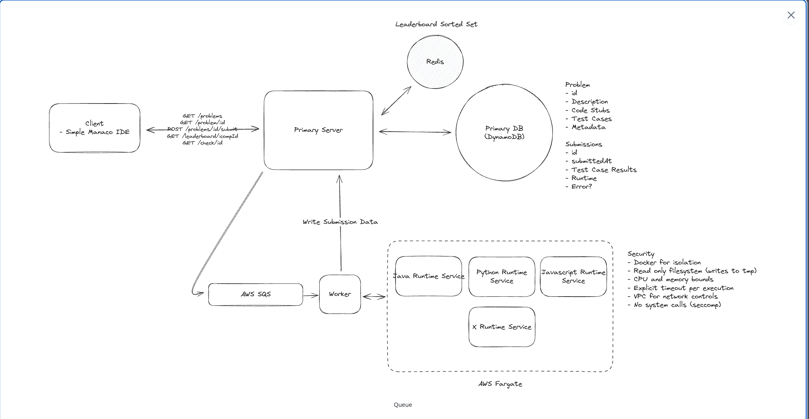
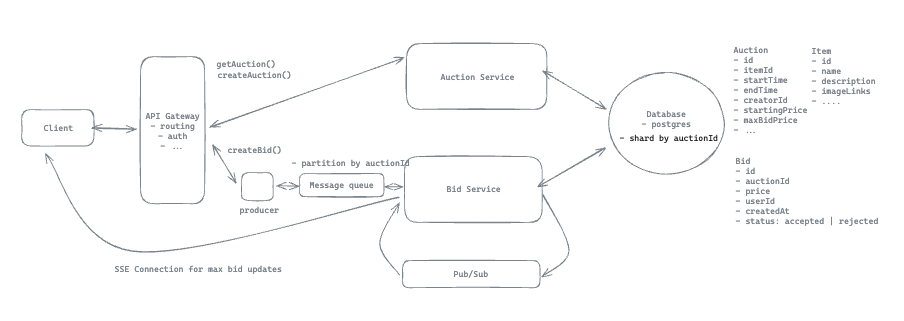
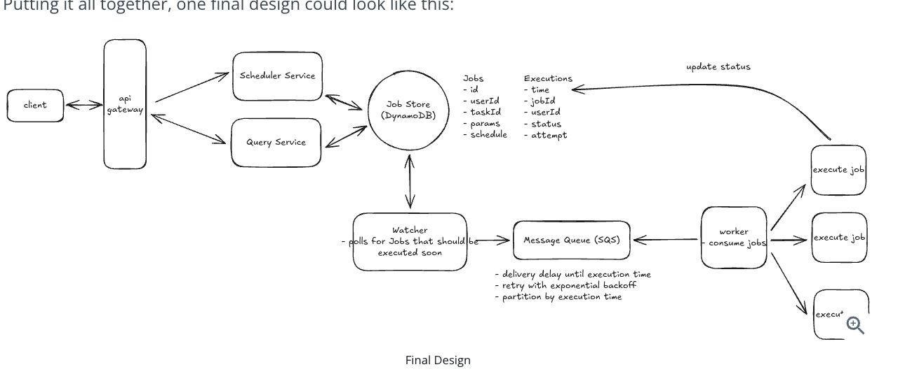
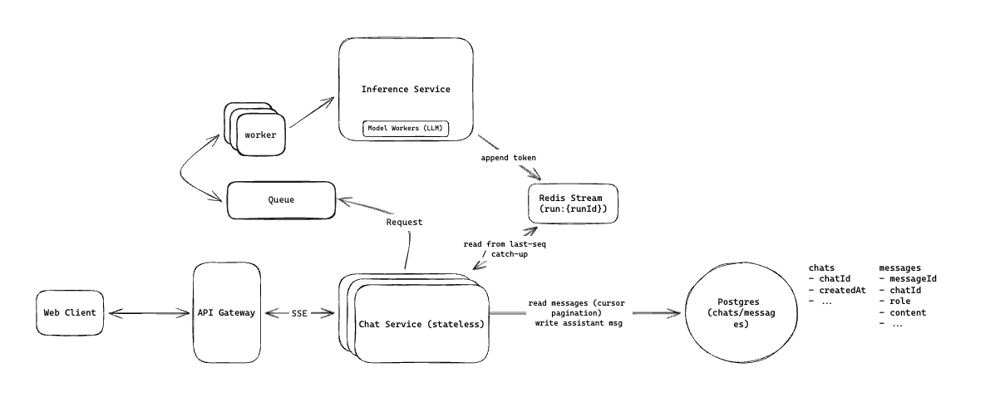

# system design

## non-functional requirements
1. what do this normal includes? how does it normally decides my design?
    1. CAP : Availablity or consistency
    2. low latency
    3. fault tolerant
    4. default scalibility

2. CAP theorem: either high-availability or high-consistency


### bitly(shorten URL)
1. use a compact encoding like base62 to shorten uuid while keep its uniqueness
2. cache first, database second on a miss
3. how to scale out the system to serve 10k QPS? (scale out reading)
    1. use CDN to store the hot keys
    2. scale the system and database horizontally across different region, 

### Bropbox(a cloud file storage system)
1. how to deal with large files(chunk)
    1. "For large files up to 50GB, we'll use chunked uploading with AWS S3's multi-part upload. The client initiates the upload with our File Service, which creates a multi-part upload in S3 and returns an upload ID. The client then splits the file into chunks, typically 5-10MB each. For each chunk, the client gets a pre-signed URL from our service and uploads directly to S3. This bypasses our servers, reducing load. The client notifies us after each chunk, allowing us to track progress and handle failures.
    2. Once all chunks are up, the client sends a completion request. We then tell S3 to combine the chunks into the final file. We update our Metadata Database throughout the process and implement resume functionality for interrupted uploads. We'll can use exponential backoff for retries and MD5 hashes for integrity checks. "

2. How can we reduce bandwidth usage and make the sync process faster than downloading full files each time they change?
    1. We'd break files into smaller chunks, maybe around 5MB each, and calculate a hash for each chunk, just like we did for resumable upload. When syncing, we'd compare these hashes to identify which parts of the file have changed and only transfer the modified chunks. This way, we're not downloading entire files for small changes. 
    2. We could also use selective compression, compressing data before transfer, especially for text-based files. We'd want to use different compression algorithms based on file type for the best results, but skip compression for already compressed files like images or videos to avoid wasting CPU resources. By combining these methods, we'd significantly cut down on data transfer during syncs, making the whole process much faster and more efficient than just downloading full files every time."

3. Design how the Dropbox desktop / mobile sync agent detects edits in the user's local Dropbox folder and uploads those changes to remote storage.
    1."For syncing local changes to remote storage, we'll use a client-side sync agent that monitors the local Dropbox folder for changes using OS-specific file system events. When it detects a change, it'll simply queue the entire file for upload.
    The agent will then use our upload API to send the changed file to the server, along with updated metadata like the modification time and file size. Our File Service will process these uploads, storing the new version in S3 and updating the Metadata Database.
    We'll use a 'last write wins' approach for handling conflicts. This simple setup allows for basic syncing of local changes to the cloud, keeping users' files up-to-date across their devices. Of course, this approach has limitations for large files or frequent changes, but it's a starting point we can build on later.

4. for sync, hybrid solution for clients to get the message of files have changed : 1. when the app is active, matain a websocket connection, once the file changed, the server would push the notification to client, and then use get request to get all the file url list 2. if not active, poll from server periodically.

### yelp (rating, and efficient search by location, name(inverted indexes), category-->simple b-tree index is OK)
1. challenge when using elastic search:
    1. The main challenge you want to be aware of when introducing Elasticsearch is that you won’t want to use it as a primary database, this is a no-no. It is not optimized to maintain transactional data integrity with full ACID compliance, nor to handle complex transactions. Additionally, Elasticsearch’s fault tolerance mechanisms, while effective, require careful configuration to avoid potential data loss during node or network failures. It’s best utilized for what it’s designed for: search and analytical operations across large datasets, rather than primary data storage.
    2. As a result, we need a way to ensure the data in Elasticsearch remains in sync (consistent) with our primary database. The best way to do this is to use a **Change Data Capture (CDC)** system to capture changes to the primary database and then apply them to Elasticsearch.
    3. This works by having all DB changes captured as events and written to a queue or stream. We then have a consumer process that reads from the queue or stream and applies the same changes to Elasticsearch
#### for api
1. Never ask the client to provide internal system details like a distributionCenterId or fulfillmentCenterId in an order request. The backend should resolve which fulfillment center to use based on the delivery address or coordinates. The customer only knows where they want their order delivered, not how your infrastructure is organized.
2. Location-based search endpoints can return a large number of results, so always add pagination support using limit and offset query parameters. This keeps response sizes manageable and prevents overloading both the server and the client.

### design ticket master
#### need a distributed lock(in redis) for users to complete the transaction

1. 


### design Instagram
1. feed
    1. why we just cant simply use fan-out on read? each time user request feed, actively pulls the post from following users in real-time??
        1. in this way, the request becomes very expensive and may not serve the low-latency requirements 
        2. so that we need a pre-computed cache --> would introduce fan-out write when a celebrity posts
    2. should have a hybrid solution:
        1. Normal account with 200 followers: fan-out on write; insert the post into those 200 feed inboxes.(--> which is a precomputed cache, like in redis, its a sorted set, with the time as value to be sort)
        2. Celebrity with 10M followers: fan-out on read; keep the post in the celebrity’s own timeline/cache.
        3. When a user reads their feed: merge “pushed” posts from normal accounts with “pulled” posts from celebrity accounts.
   3. 发帖先把 Post 落库（媒体走 S3，处理完再 ready），再 入队 fan-out：普通用户把 postId 写入每人一份的 Feed 表（这才是预计算 inbox），名人跳过、读时再 merge；Redis 只缓存帖子正文（读 feed 时按 id 去 Post 表回填），不要在 fan-out 里和 Feed 表对等双写时间线。读路径是 Feed 表取 id → Redis hydrate，miss 才打 Post 表。图上的问题就是把 Redis 画成了预计算 feed、fan-out 指到 Post 库、队列方向反了——预计算在 Feed 表，缓存是派生数据，挂了从 Feed/Post 表补，不要把帖标失败。

### Tinder
#### Non-funcitional requirements
1. consistency is favored over availability when matching

#### match actions
1. how to process it both rapidly and consistently?
    1. we can store it in redis and when matched, store it in database?
    2. because redis is single-thread and can perform atomic operations, so when 2 users swipes for each other concurrently, their operations are being processed sequentially
    3. scale redis to clusters with database shardings on keys like pair(smallerUserId, largerUserId), so whenever a later swipes comeback in, it will lands on the same node in redis cluster
    4. for storage, we latter periodically put matched pairs in database.


### Leetcode
1. how to handle 100k submission and competition ?
   1. use a message due:
      1. 


### whatsapp (chat app)

1. how to scale this to support 

2. when scaling, there must be multiple chat servers, how do you deal with the situation that in one chat, different clients might connects to different chat servers?

   1. In a distributed chat system, the sender and receiver are often connected to **different WebSocket servers**.

      Example:

      ```text
      Alice is connected to Chat Server A
      Bob is connected to Chat Server B
      ```

      Alice sends “hi” to Bob:

      ```text
      Alice → Server A
      ```

      Server A needs to deliver it to Bob, but Bob’s live WebSocket connection is held by Server B—not Server A. Server A cannot directly write to Bob’s socket.

      That is the “bouncing messages between servers” problem.

      ## Redis Pub/Sub solution

      Each WebSocket server subscribes to Redis channels for the users currently connected to it.

      ```text
      Bob connects to Server B
      → Server B subscribes to Redis channel: user:Bob
      ```

      When Alice sends a message:

      ```text
      Alice
        → Server A
        → save message in Chat DB
        → Redis PUBLISH user:Bob {message}
        → Server B receives it
        → Server B sends it through Bob's WebSocket
      Alice ──WS──> Server A ──publish──> Redis
                                            │
                                        channel user:Bob
                                            │
      Bob <──WS── Server B <──subscribe─────┘
      ```

      Redis knows, in memory, roughly:

      ```text
      user:Bob → [connections / subscribers on Server B]
      ```

      So it can quickly route a published event to the correct server(s).

      ## Why Redis Pub/Sub is lightweight

      Redis Pub/Sub does **not store the message history**.

      When Server A publishes:

      ```text
      PUBLISH user:Bob "hi"
      ```

      Redis immediately forwards it to the current subscribers. Then it discards it.

      If Bob’s server temporarily loses its Redis connection at that moment, that Pub/Sub delivery is missed. This is called **at-most-once delivery**:

      > A subscriber receives the event zero or one time—never guaranteed to receive it.

      For real chat, you usually store the message in a durable database *before* publishing. If the live push fails, Bob can fetch the missing message later through a normal sync API when reconnecting.

      ## Why not Kafka for this specific step?

      Kafka persists messages to disk and tracks how far each consumer has read.

      ```text
      Kafka topic/partition:
      message 1 → stored
      message 2 → stored
      message 3 → stored
      consumer offset → “I have processed through message 2”
      ```

      That is valuable when you need reliable asynchronous processing, replay, analytics, notifications, moderation, etc.

      But for “Bob is online; send this event immediately to whichever WebSocket server holds his connection,” Kafka can be heavier than needed:

      - messages are written to disk;
      - consumers maintain offsets;
      - data remains for a retention period;
      - routing a single user to a currently connected gateway is less direct.

      Redis Pub/Sub is fast because it behaves more like an in-memory event switch:

      ```text
      channel name → currently connected subscribers
      ```

      No storage, no replay, no offsets.

      ## Why shard Redis?

      One Redis instance cannot handle every connected user/channel at massive scale.

      So partition by user ID, for example:

      ```text
      hash(userId) % 100
      user:Bob   → Redis shard 12
      user:Carol → Redis shard 67
      ```

      All servers use the same deterministic rule, so Server A knows which Redis shard to publish to, and the WebSocket server knows which shard/channel to subscribe to.

      One nuance: if Bob has two devices connected through different servers, both servers can subscribe to `user:Bob`, and both devices receive the live event.

#### use dynamoDB to store message

1. DynamoDB is designed for very high-volume key-based reads/writes with automatic horizontal scaling.

#### What happens if the web socket connection fails?

1. Application-level heartbeats
   1. from chat server to user, if user failed to response, close the connection to save the resource

### Distributed cache(like redis)

#### use consistent hashing to shard the data

1. it minimize the number of keys to be remapped when the total number of nodes changes

### rate limiter

#### token bucket algorithm

1. In a token bucket, you usually **remove a token**, not a request.

   For each incoming request:

   1. Refill tokens based on elapsed time, up to bucket capacity.
   2. Check whether there are enough tokens for this request.
      - Usually a normal request costs `1` token.
      - A larger request might cost more (e.g. bytes uploaded).
   3. If enough tokens exist, decrement that many tokens and let the request proceed.
   4. If not, either:
      - **reject/drop** the request (rate limiting), or
      - **put it in a queue** until tokens become available (traffic shaping).

   So the decision is simply:

   ```java
   if (tokens >= requestCost) {
       tokens -= requestCost;  // consume token(s)
       allowRequest();
   } else {
       rejectOrQueueRequest();
   }
   ```

   Example: bucket capacity = 10, refill rate = 2 tokens/sec. If it currently has 3 tokens:

   - A normal request costing 1 → accepted; remaining tokens = 2.
   - A request costing 5 → not enough tokens → reject or wait.

   The request itself is only “removed” from a queue if you use the shaping/queueing version and decide to drop it—for example, the queue is full or it has waited past a timeout.

2. how do we decide the refill rate and bucket capacity then?  say we limit 100 request per second per user?

   1. For a limit of **100 requests/second per user**:

      - **Refill rate** = `100 tokens/second`
      - **Bucket capacity** = how much short burst you want to allow

      Each request costs 1 token.

      For example:

      | Configuration                  | Meaning                                                      |
      | ------------------------------ | ------------------------------------------------------------ |
      | refill = 100/s, capacity = 100 | User can send up to 100 immediately, then sustain 100/s      |
      | refill = 100/s, capacity = 200 | User can briefly burst to 200 requests, then sustain 100/s   |
      | refill = 100/s, capacity = 10  | Very little burst allowed; behavior is close to evenly spaced requests |

      A common starting point is:

      ```text
      refill rate = 100 tokens/sec
      capacity = 100 tokens
      ```

      This means the long-term average cannot exceed 100 RPS, while a user who has been idle can make a short burst of up to 100 requests.

      Internally, don’t refill once every second in a timer; calculate it lazily when a request arrives:

      ```text
      newTokens = elapsedSeconds × 100
      tokens = min(capacity, tokens + newTokens)
      ```

      Then consume one token if `tokens >= 1`.

      One subtle point: with capacity 100, a user who was idle can send 100 requests instantly, then after 1 second send another 100. That’s acceptable because the average over a longer period is bounded, but it is a bursty policy. If downstream services cannot tolerate that burst, reduce the capacity—e.g. capacity 20—while keeping the refill rate at 100/s.

#### use ZooKeeper to push configuration if needed imediate change on rules

#### how do we minimize latency

1. *Colocation is key. We want our gateways and Redis instances in the same data center, ideally the same rack, to keep network latency under a millisecond. Cross-region calls would add 50-100ms which is way too much.*
2. *For global scale, we'll deploy regional clusters. A user in Asia hits the Asia cluster, Europe users hit the Europe cluster, etc. This means rate limits might not be perfectly consistent across regions - a user could potentially get 100 requests in Asia and another 100 in Europe - but the alternative is adding huge latency for cross-region synchronization. For most use cases, this eventual consistency is acceptable.**"*

### Auction Platform like eBay

1. How can we ensure strong consistency for bids?
   1. which means every user are seeing the same price --> which means 
   2. A bid is not just “write a row.” You must check and change related state as one indivisible operation:
      - auction is still open
      - bid amount is higher than the current highest bid
      - optionally bidder has sufficient balance / valid authorization
      - record the bid
      - update the auction’s current winning bid
2. Use SSE for real-time update the result of the current higest bid
   1. Will need a Pub/Sub broker to broadcast the notification 
   2. 

### Job scheduler

1. 
2. why use dynamoDB here?

### Design Chatgpt

1. SSE is good for having a low TTFT(time to first token), but it requires long connections from service to users-end. So naive design cant tolerate fault either from server or user client, or the network.
2. Reconnect — Wi‑Fi blip, laptop sleep, nginx 60s timeout, user refreshes. The old SSE is dead. A new request hits pod B, which never saw the first tokens. B does `XREAD run:{id} from lastSeq` and continues the stream. Without Redis, those tokens only lived in pod A’s memory → user sees a broken sentence or a duplicate full regenerate.
   1. so the solution would be a Redis Stream, so the inference serive would add, which is append the generated tokens to this redis stream log, with a uniqueId for that chat, and for any service want to read that chat,  it just needs to read from last sequence number to catch up.
3. 

## default patterns

### dealing with contention

#### how to avoid deadlock when using pessimistic lock?
1. use ordered locking
say there are 2 events happenes concurrently, A send B : lock A and requires B's info:  and B send A: instead of lock B and requires A, always choose one with lower userId to lock first.

#### what's the difference between pessimistic lock and transaction?
A **transaction** and a **pessimistic lock** are not alternatives—they solve different problems.

* A **transaction** defines a unit of work that should follow ACID properties, especially: either all operations commit, or all roll back.
* A **pessimistic lock** is one concurrency-control technique used inside a transaction to stop other transactions from modifying, and sometimes reading, selected data.

For example, transferring $100 from Alice to Bob:

```sql
BEGIN;

SELECT balance
FROM accounts
WHERE user_id = 123
FOR UPDATE;                 -- pessimistic row lock

UPDATE accounts
SET balance = balance - 100
WHERE user_id = 123;

UPDATE accounts
SET balance = balance + 100
WHERE user_id = 456;

COMMIT;                     -- releases the lock
```

The transaction guarantees that both balance updates succeed together or both are rolled back.

The `FOR UPDATE` pessimistic lock guarantees that another transaction cannot simultaneously acquire a conflicting lock and modify Alice’s account before this transaction finishes.

Without explicit pessimistic locking, you can still use a transaction:

```sql
BEGIN;

SELECT balance FROM accounts WHERE user_id = 123;
-- application checks the balance
UPDATE accounts SET balance = balance - 100 WHERE user_id = 123;

COMMIT;
```

However, another transaction could modify the balance between the `SELECT` and `UPDATE`, depending on the database and isolation level. This can cause a race condition.

A useful comparison:

| Concept               | Transaction                                | Pessimistic lock                        |
| --------------------- | ------------------------------------------ | --------------------------------------- |
| Main purpose          | Make several operations one atomic unit    | Prevent concurrent access conflicts     |
| Typical syntax        | `BEGIN`, `COMMIT`, `ROLLBACK`              | `SELECT ... FOR UPDATE`                 |
| Lifetime              | From `BEGIN` to commit/rollback            | Usually held until its transaction ends |
| Always blocks others? | Not necessarily                            | Yes, for conflicting operations         |
| Can exist together?   | Yes—locks normally belong to a transaction | Usually used inside a transaction       |

The relationship is:

> The transaction defines the boundary; the pessimistic lock protects specific records during that boundary.

Also, ordinary `UPDATE` statements already acquire database locks. Explicit pessimistic locking is especially useful when you must first read data, make a decision in application code, and then update it safely.

### Managing long running tasks

1. how to deal with the situation where workers shut down?
   1. we periodically send heartbeats(10s) to workers to test if it is alive, if not, we consider the worker is crashed, and reenque the job
2. how to prevent duplicated work
   1. if a user managed to send the same request multiple times in a short period of time:
      1. use a uniquekey: like userId+action+ timestamp(for example: 1minute)
      2. 


### Realtime Leaderboard

1. Availability > consistency 
   1. can use redis sorted set
2. how do we consider realtime?
   1. we can use periodically polling for updates, to trade-off real-time for simplicity

### how can we get consistency?

1. The typical scenario is: **multiple requests concurrently try to change the same logical resource, and the final result must obey an invariant.**

   Examples:

   | Resource            | Concurrent requests           | Invariant                                     |
   | ------------------- | ----------------------------- | --------------------------------------------- |
   | Auction `A123`      | Many users place bids         | Highest valid bid wins; price never decreases |
   | Seat `S8`           | Many users try to buy it      | At most one confirmed owner                   |
   | Bank balance        | Two payments arrive           | Balance must not go below zero                |
   | Username            | Many users register `alice`   | Only one account owns it                      |
   | Tinder pair `(A,B)` | Both users swipe concurrently | Create at most one mutual match               |

   The first design question is: **what is the unit of contention?**
   Not “the entire database,” but usually one seat, one auction, one user-pair, or one account.

   Then choose a strategy.

   | Strategy                               | How it works                                                 | Best when                                            |
   | -------------------------------------- | ------------------------------------------------------------ | ---------------------------------------------------- |
   | Conditional write / optimistic locking | Update succeeds only if the version/state you read is still current; otherwise retry or reject | Conflicts are relatively uncommon                    |
   | Row lock / serializable transaction    | Lock the resource while validating and updating it           | Logic needs multiple reads/writes together           |
   | Single owner / sequencer               | Route all commands for one resource to one partition/consumer, which processes them in order | One resource is very hot                             |
   | Unique constraint                      | Let the DB enforce “only one”                                | Duplicate ownership/creation                         |
   | Distributed lock                       | Acquire an external lock before processing                   | Usually avoid unless DB cannot express the invariant |

   For example, selling one seat:

   ```sql
   UPDATE seats
   SET status = 'HELD', hold_owner = :userId
   WHERE seat_id = :seatId
     AND status = 'AVAILABLE';
   ```

   If one request changes the row first, every other concurrent request updates `0` rows and gets “seat is no longer available.” That is a simple conditional write—no explicit lock service required.

   For a popular auction, optimistic locking can cause too many retries:

   ```text
   1,000 bids → all read bid = $100
   → only one can update to version 51
   → 999 fail, reread, and retry
   ```

   Then route all bids for the same `auctionId` to one sequencer/queue partition:

   ```text
   auctionId = 123 → one ordered consumer
   ```

   That consumer evaluates `$101`, `$105`, `$103` in a single order and updates durable state. Different auctions can still be handled in parallel.

   The rule of thumb:

   ```text
   Low contention → conditional update / optimistic lock
   Moderate contention + multi-step invariant → DB transaction / row lock
   High contention on one key → partition by that key and serialize commands
   ```

   In all cases, the authority must be durable and strongly consistent for that resource. Redis may help route, cache, or rate-limit, but should not be the only source of truth for a payment, seat ownership, or auction winner.

## normal trade-off patterns for system design

1. Most system-design decisions are variations of a small set of trade-offs. In an interview, state: **requirement → cost → chosen trade-off**.

   | Trade-off                              | Choose left when                                           | Choose right when                                            |
   | -------------------------------------- | ---------------------------------------------------------- | ------------------------------------------------------------ |
   | Consistency vs availability            | Incorrect data is unacceptable: payment, seat, auction bid | Temporary stale/unavailable data is okay: feeds, likes, presence |
   | Latency vs correctness/durability      | Fast response matters; cache or async work is acceptable   | Must confirm durable result before replying                  |
   | Synchronous vs asynchronous            | Caller needs the result now                                | Work is slow, retryable, or can happen later                 |
   | Throughput vs per-request latency      | Batch, queue, or buffer requests                           | Process immediately, even if less efficient                  |
   | Read performance vs write cost         | Add indexes, replicas, materialized views, caches          | Keep writes simple/cheap                                     |
   | Storage cost vs query speed            | Store denormalized/precomputed data                        | Normalize and compute/join at read time                      |
   | Flexibility vs performance             | General SQL queries and evolving access patterns           | Known access patterns; specialized key-value schema          |
   | Ordering vs parallelism                | One ordered stream per auction/account                     | Partition work for high throughput across independent keys   |
   | Strong isolation vs concurrency        | Lock/serialize a hot resource to protect invariants        | Optimistic updates/retries when conflicts are rare           |
   | Simplicity vs scalability              | One DB/service is sufficient initially                     | Shard, queue, and split services at very high scale          |
   | Freshness vs cost                      | Serve cached/eventually consistent data                    | Read from primary / strongly consistent source               |
   | Availability vs overload protection    | Admit all traffic and risk collapse                        | Rate-limit, shed load, or queue requests                     |
   | At-most-once vs at-least-once delivery | Losing an unimportant notification is okay                 | Do not lose tasks; accept duplicates and make consumer idempotent |
   | Push vs pull                           | Need real-time updates: WebSocket/SSE/webhook              | Periodic or user-driven checking: polling                    |

   A few very common patterns:

   ```text
   Flash-sale tickets:
   protect inventory correctness
   → conditional DB write
   → rate limiter + queue to absorb burst
   → reject/hold users instead of overload
   Social feed:
   availability and low latency matter more than instant accuracy
   → cache / async fan-out
   → eventual consistency is acceptable
   Payment:
   durability and correctness matter most
   → synchronous, transactional write
   → idempotency key
   → retry carefully
   Popular auction:
   one hot auction requires strict ordering
   → conditional update at moderate load
   → per-auction queue/sequencer at high contention
   ```

   A strong interview sentence is:

   > “I’m trading a little freshness and implementation complexity for lower read latency. This is acceptable because the data is not financial or correctness-critical; the database remains the source of truth.”

   Or, for the other direction:

   > “I’ll sacrifice availability during a partition and fail closed, because accepting an incorrect bid or selling the same seat twice is worse than rejecting a request temporarily.”

