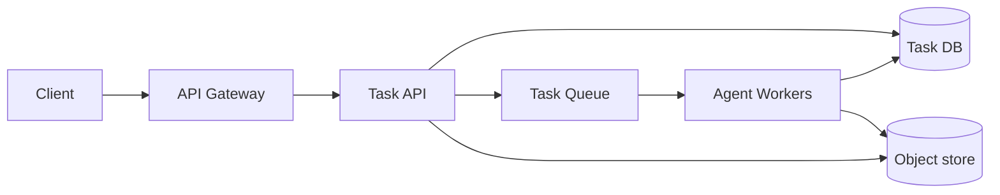

# Enterprise AI Agent Task Platform

> Hello Interview delivery: Requirements → Core entities → API → Data flow → High-level design → Deep dives.
>
> TikTok NG R1 (paraphrase): enterprise users submit jobs to an AI agent. Each job runs **1–9 minutes**. Users must **see status** and **cancel**. Follow-up: the job is **already in the DB**, then the service crashes **before the message hits the queue**.

Pattern: **Managing Long-Running Tasks** (accept fast, process in the background). The interesting part is not the queue — it is **DB as source of truth**, because HTTP, the process, and the broker can all die independently.

---

## 1. Requirements (~5 min)

Do not design ChatGPT. Design a **job control plane** in front of an agent runtime you can treat as a black box.

### Functional

Users / clients should be able to:

1. **Submit** an agent task and get a `taskId` immediately (do not block 1–9 min on HTTP).
2. **Read status** of a task they own (`PENDING` / `QUEUED` / `RUNNING` / `SUCCEEDED` / `FAILED` / `CANCELLED`), plus a result or error when terminal.
3. **Cancel** a task that has not finished.

Out of scope unless they ask: multi-step workflows, human-in-the-loop mid-run, billing, prompt versioning, multi-tenant quotas UI.

### Non-functional

Quantify. “Highly available” is not a requirement.

| # | Requirement | Why it drives design |
|---|---|---|
| 1 | **Submit p99 < 200ms**; never hold the API for the agent | HTTP/LB timeout ~30–60s; work is 1–9 min |
| 2 | **Durability of the request**: once `201/202` is returned, the job must not vanish if a pod dies | This is the follow-up |
| 3 | **At-least-once execution with idempotent workers** | Queue + retry will duplicate |
| 4 | **Cancel is prompt**: queued work never starts; running work stops within one heartbeat (~few seconds), not at the 9-min wall | Cooperative cancel |
| 5 | **Consistency over availability for a single task’s state** | Two workers must not both “succeed” the same `taskId` |
| 6 | **Fault tolerance** of workers: crash mid-run → retry or fail cleanly, not silent `RUNNING` forever | Lease / heartbeat |

CAP on **task status**: prefer **strong consistency** (one row in the primary DB). Stale cache on `GET` is OK for a second; double-run is not.

### Capacity (only what changes the design)

Enterprise, not For-You-Page.

Assume: 10k DAU, 20 tasks/user/day → ~2e5 tasks/day → **~3 QPS average submit**, maybe **30–50 QPS peak**. Boring for the API.

The scarce resource is **concurrent agent runs**, not request QPS.

- Mean runtime ~5 min = 300s.
- If peak is 10 submits/s sustained for a bit, in-flight ≈ `10 × 300 = 3000` running agents.
- Design the **worker pool + queue** for thousands of in-flight jobs; the API tier is stateless and small.

Skip storage theater: task metadata is tiny. Put large artifacts (traces, files, logs) in object storage; DB only holds pointers.

---

## 2. Core entities (~2 min)

First draft — names, not every column.

- **User** — enterprise identity (from auth token).
- **Task** — the job: prompt/payload, status, timestamps, result pointer, cancel flag, lease.
- **AgentRun** (optional, same row at NG) — which worker, attempt count, heartbeat. Can stay columns on `Task` until you need a run history.

Actors: **submitter** (human/client) and **worker** (agent runtime). They must not share the HTTP request.

---

## 3. API (~5 min)

REST. Current user from the **auth token**, never from the body.

Submit is **async**: validate, persist, return **202** + `taskId`. Client polls (or SSE later).

```
POST /v1/tasks
Idempotency-Key: <client uuid>
body: {
  "prompt": string,
  "input_ref": string | null,   // S3/OSS key if payload is large
  "priority": "normal" | "high" // optional
}
→ 202 Accepted
{
  "task_id": "tsk_...",
  "status": "PENDING"
}

GET /v1/tasks/{taskId}
→ 200
{
  "task_id": string,
  "status": "PENDING|QUEUED|RUNNING|SUCCEEDED|FAILED|CANCELLED",
  "progress": 0.0-1.0 | null,
  "error": string | null,
  "result_ref": string | null,  // object-store pointer, not a 20MB blob in JSON
  "created_at": iso8601,
  "updated_at": iso8601
}

POST /v1/tasks/{taskId}/cancel
→ 200 { "task_id", "status": "CANCELLED" | "RUNNING" }
  // RUNNING means cancel requested; worker will stop
→ 409 if already terminal
```

`GET /v1/tasks?status=&cursor=` is nice for a dashboard; not required to start.

**Idempotency-Key** on submit: same user + same key → same `taskId`. Retried POSTs after a timeout must not spawn two agents.

---

## 4. Data flow (this problem needs it)

1. Client `POST /tasks` → API validates auth + payload.
2. API **inserts Task `PENDING`** (and an outbox row) in **one DB transaction**.
3. Commit. Return **202** + `taskId`.
4. Publisher (same process *or* a separate poller) puts `{task_id}` on the **queue**.
5. Worker **claims** the task (`PENDING|QUEUED` → `RUNNING` + lease).
6. Worker runs the agent 1–9 min, heartbeats, watches cancel.
7. Worker writes result to object storage, then **CAS** status to `SUCCEEDED` / `FAILED`.
8. Client `GET`s status. Optional: push events.

If you swap 2 and 4 (enqueue then persist, or persist then enqueue with no recovery), you get the crash bug they asked about.

---

## 5. High-level design (~10–15 min)

Start simple enough to **satisfy the three APIs**. Dual-write recovery is a deep dive — say it out loud and park it.

```text
 Client                    API (stateless)
   |-- POST /tasks ---------->|  1. INSERT task PENDING (+ outbox)  [txn]
   |<-- 202 task_id ----------|  2. return immediately
   |                          |
   |                          |  3. publish task_id  --->  Queue
   |                          |
   |-- GET /tasks/{id} ------>|  read Task row (DB; Redis optional)
   |-- POST .../cancel ------>|  set cancel_requested / CANCELLED

 Queue  -->  Agent Workers (autoscaled)
                |  claim + lease
                |  run agent (sandbox / GPU / tools)
                |  heartbeat, cooperative cancel
                v
         Task DB (source of truth)     Object store (results, traces)
```



### Components (what each is for)

| Box | Role |
|---|---|
| **Task API** | Auth, validate, persist, cancel, GET. **No agent execution.** |
| **Task DB** | Source of truth for status. Postgres is enough at this QPS; Dynamo if they are already on it (`PK=task_id`). |
| **Queue** | Buffer + backoff. SQS / Rabbit / Kafka. At this QPS, SQS-style **visibility timeout** is a better default than Kafka. |
| **Workers** | Pull jobs, run the 1–9 min agent, update DB. Scale independently of API. |
| **Object store** | Results, logs, traces. DB keeps `result_ref`. |

Call out, then move on: “We’ll put Redis in front of GET later if the dashboard is chatty. Not needed for correctness.”

### Schema (only columns that matter)

**Task**

| Column | Notes |
|---|---|
| `task_id` | PK |
| `user_id` | from auth |
| `idempotency_key` | unique with `user_id` |
| `status` | state machine below |
| `cancel_requested` | bool |
| `payload_ref` | object store / inline if small |
| `result_ref` | |
| `error` | |
| `attempt` | retry count |
| `worker_id` | current owner |
| `lease_until` | heartbeat deadline |
| `created_at` / `updated_at` | |

**Outbox** (deep dive 6.1; you can draw it next to the DB now)

| Column | Notes |
|---|---|
| `id` | PK |
| `task_id` | |
| `payload` | `{task_id}` is enough |
| `created_at` | |
| `published_at` | null = not yet on the queue |

### State machine

```text
                    cancel
                       |
PENDING -----> QUEUED -----> RUNNING -----> SUCCEEDED
   |              |             |              FAILED
   |              |             |              CANCELLED
   +--------------+-------------+
         cancel before/during run
```

Legal transitions are **CAS** in the DB (`UPDATE ... WHERE status IN (...)`). That is the lock. Do not use Redis as the lock for “who runs this task.”

---

## 6. Deep dives (~10+ min)

### 6.1 Follow-up: DB write succeeded, process died before MQ

**What happened**

```text
BEGIN
  INSERT tasks (PENDING)
  INSERT outbox
COMMIT          ← user got 202, row is durable
publish(queue)  ← crash here
```

The job **exists** and **never runs**. A wall-clock timer that marks it `FAILED` after 10 minutes is the wrong tool:

- Runtime is 1–9 min, so the timer must be **> 9 min** or you kill healthy work.
- This job **never started**. Failing it after 10 minutes wastes the user; you should **re-enqueue**.
- Timer cannot tell apart: never queued / queued but delayed / worker dead with a held lease.

**Correct rule:** *Once we return 202, DB is the contract. The queue is an accelerator. Missing messages are recovered, not timed out.*

**Transactional outbox (say this)**

1. Same transaction: `Task` + `Outbox` row.
2. A **publisher** (API sidecar, or a small poller, or CDC/Debezium) `SELECT ... WHERE published_at IS NULL`, `publish(task_id)`, then set `published_at`.
3. Crash after commit, before publish: outbox row is still unpublished. Poller retries in seconds, not minutes.
4. Publish is **at-least-once** → workers must be idempotent (6.4).

Equivalent without a second table: sweep

```sql
SELECT * FROM tasks
WHERE status = 'PENDING'
  AND created_at < now() - interval '15 seconds';
```

and re-publish `task_id`. Same idea: **reconcile intent in DB with the queue**.

This is the same pattern as **DB = intent, runtime = fact, reconciler closes the gap**.

**Where a timer *does* belong:** not here. See 6.3 (lease) and 6.7 (SLA).

---

### 6.2 Cancel

Cancel is a **DB write**, not “delete the Kafka message” (you often cannot).

| Current status | Cancel behavior |
|---|---|
| `PENDING` / `QUEUED` | CAS → `CANCELLED`. Reconciler/worker that later sees the message **no-ops** (status already terminal). |
| `RUNNING` | Set `cancel_requested=true` (and optionally keep status `RUNNING`). Worker heartbeats, sees the flag, stops the agent, CAS → `CANCELLED`. |
| Terminal | `409`. |

Worker loop (every few seconds):

1. Renew lease if still working.
2. `SELECT cancel_requested FROM tasks WHERE task_id=?`
3. If true: kill the agent process / abort the sandbox, then CAS to `CANCELLED`.

You cannot preempt a stuck GPU kernel instantly; **cooperative cancel + lease expiry** is the honest answer. Do not promise “cancel = instant SIGKILL of a distributed tool call.”

---

### 6.3 Worker crashes mid-run (the other crash)

Different from 6.1. The message was consumed; the agent was in minute 4 of 7; the box died.

If you only ACK the queue at pull time, the job is gone and the row stays `RUNNING` forever. If you never ACK, the message returns after **visibility timeout**, but a **second worker** might start while the first is still alive (slow GC, network blip).

**Lease / heartbeat** (this is the lock):

1. Claim:

```sql
UPDATE tasks
SET status = 'RUNNING',
    worker_id = :me,
    lease_until = now() + interval '30 seconds',
    attempt = attempt + 1
WHERE task_id = :id
  AND status IN ('PENDING', 'QUEUED')
  AND cancel_requested = false;
```

If 0 rows: another worker owns it, or it was cancelled. ACK and skip.

2. While running, every ~10s: `lease_until = now() + 30s` **only if** `worker_id = me`.
3. Sweeper: `RUNNING AND lease_until < now()` → set back to `PENDING`/`QUEUED` (or `FAILED` if `attempt >= max`) and re-publish.

Queue **visibility timeout** should be **≥ heartbeat**, not 9 minutes. Long VT hides dead workers; short VT + lease in DB is the real mutex.

SQS: extend visibility while heartbeating (`ChangeMessageVisibility`). Same idea.

---

### 6.4 At-least-once: outbox + MQ retries

You will get duplicate `{task_id}` messages. That is required for 6.1.

Safe because **claim is CAS**. Duplicate delivery: second worker’s `UPDATE ... WHERE status IN ('PENDING','QUEUED')` returns 0. Done.

Do **not** start the agent and then write `RUNNING`. That window is a double-run.

Retries of a **failed** attempt: increment `attempt`, cap (e.g. 3), then `FAILED` + DLQ. Agent side effects (emails, tickets) need **idempotency keys** into downstreams; mention it, don’t design Stripe.

---

### 6.5 How the user sees status

| Mechanism | Use |
|---|---|
| **GET poll** (1–2s) | Default for NG. Simple, fits 1–9 min. |
| **SSE / WebSocket** | Push `status` / `progress` if they want a live panel. API is still not the worker; worker writes DB (or Redis pub/sub) and a gateway streams. |
| **Webhook** | Enterprise callback on terminal state. |

Source of truth remains the **Task row**. SSE is a cache of that row. After reconnect, client **GETs** once.

Progress: worker updates `progress` on heartbeat. Best-effort. Never invent 100% before the CAS to `SUCCEEDED`.

---

### 6.6 Scale and isolation of agents

API scales on QPS (easy). Workers scale on **in-flight 1–9 min jobs**.

- Separate **worker ASG** from API. Queue depth → desired replicas.
- One worker process **one task** (or a small concurrency with isolation). Shared-nothing: task state in DB, files in object storage.
- Run the agent in a **sandbox** (container / Firecracker / your FC story): untrusted code, bounded CPU/mem/wall clock (**hard cap ~10–12 min** > 9 min SLA).
- Fairness: per-tenant concurrency limit in Redis (`INCR tenant:{id}:running` with TTL) before claim, so one enterprise cannot eat the pool.
- Hot partition: queue key is `task_id` (random). Do not shard by `user_id` if one tenant submits a storm — use a **tenant quota** instead.

If they push GPU: the queue is still the buffer; the **GPU pool** is a second, smaller worker class. Same claim protocol.

---

### 6.7 What timeouts are actually for

| Timeout | Meaning |
|---|---|
| HTTP on `POST /tasks` | Only the persist path. Milliseconds. |
| Outbox publisher lag | Seconds. **Recovery**, not failure. |
| Worker lease | Tens of seconds. Detect dead workers. |
| Agent wall clock | ~10–12 min. Kill runaway agents; then `FAILED` (or retry). |
| User-facing SLA | e.g. 15 min still non-terminal → show failed / “contact support”, page on-call. **Last resort.** |

Do not use the SLA timer as the mechanism that **discovers “never enqueued.”** That is the outbox.

---

## 7. What to say in 60 seconds if they only ask the follow-up

> Returning 202 means we committed the task. The queue is not in that transaction, so a crash can drop the publish. I would not mark it failed on a timer — the job never ran, and 1–9 minute jobs make that timer either too aggressive or too slow. I write the task and an outbox row in one commit. A reconciler publishes unpublished outbox rows. Workers claim with compare-and-swap on `task_id`, so a second publish is safe. The timer is only for expired leases and a hard wall-clock cap.

---

## 8. Interview sequence (don’t skip HLD)

1. Name the pattern: long-running task, 202 + `taskId`.
2. Three APIs. Auth from token. Idempotency-Key.
3. Boxes: API, DB, queue, workers, object store. Walk **submit** then **GET** then **cancel**.
4. Ask them where they want to go — they will likely go to **crash after insert**. Outbox + CAS claim.
5. If time: lease, cooperative cancel, sandbox wall clock.

Do not start with Kafka partitions or Temporal unless they ask for multi-step durable workflows. For a **single 1–9 min agent run**, Postgres + SQS + outbox + lease is the complete design.
