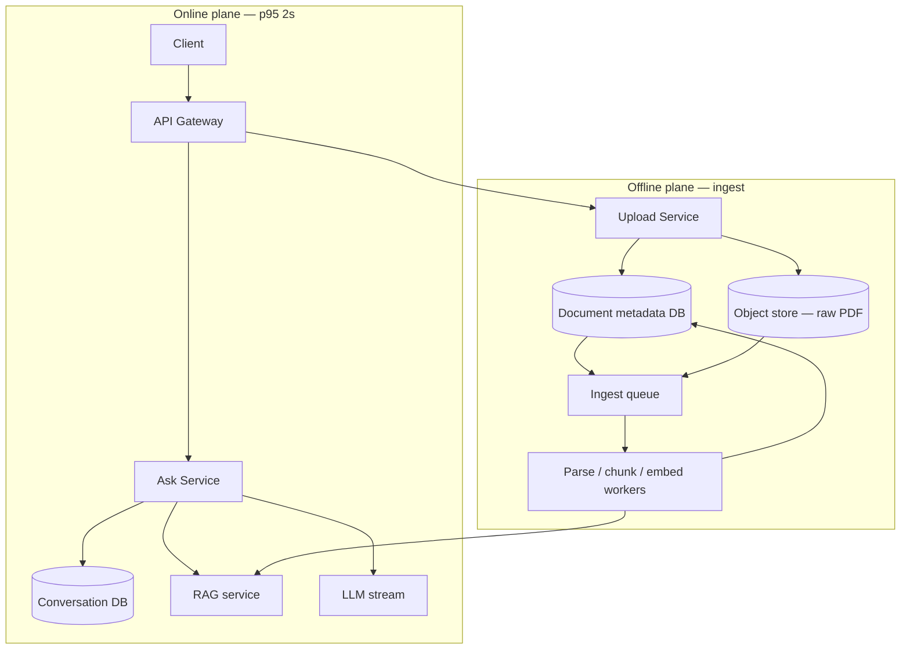
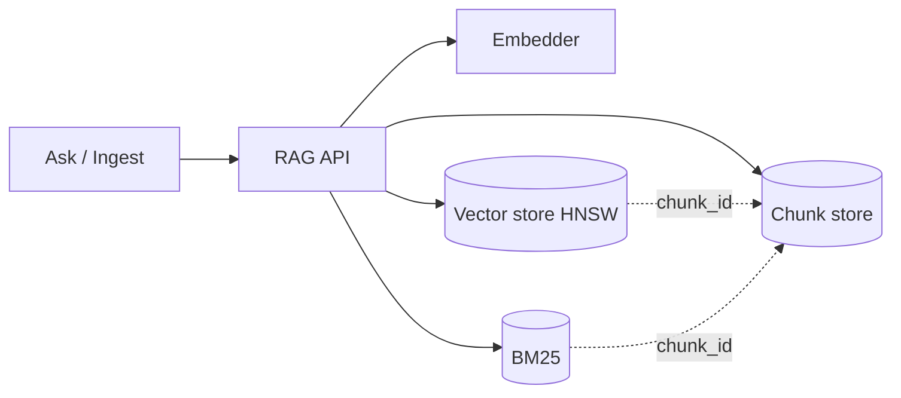

# Enterprise Knowledge-Base Agent Q&A

> Progressive interview: **architecture first**, then four constraints. Same delivery as Hello Interview: FR/NFR → numbers → boxes → only then deep dives.
>
> Not ChatGPT. **Retrieve-then-generate over private docs, ACL at retrieve, citations.** Pair with `rag_system_design.html` (HNSW) and `engineering_knowledge_base.html` (agents as consumers). Ingest of a 1000-page PDF is the **long-running task** pattern (`enterprise_agent_tasks.md`).

Clarify in 20 seconds: p95 **2s** = **TTFT** (first token) with streaming; full answer may be 5–8s. If they mean full JSON in 2s, you need a small model + short context + no fat reranker.

---

## 0. Numbers (say before boxes)

| Quantity | Value | Why it matters |
|---|---|---|
| DAU | 10万 | |
| Asks / user / day | 5 | |
| Queries / day | **50万** | |
| Average QPS | 5e5 / 8.64e4 ≈ **6 QPS** | API is trivial |
| Peak (追问 2: ×3) | **~18 QPS** | Still not a Kafka problem |
| p95 | **2s** | Budget is **GPU generate**, not QPS |

Scarce resource = **LLM tokens / GPU**, plus **per-tenant indexes**, plus **ingest of fat PDFs**. Do not design Instagram QPS theater.

Latency budget (online ask):

```text
auth + route     ~20 ms
embed query      ~20–40 ms
hybrid retrieve  ~50–150 ms     HNSW + BM25
rerank (optional)~50–150 ms     skip on easy queries
generate TTFT    ~400–1200 ms   the rest of the 2s
```

---

## 1. Main problem — overall architecture

### Functional (keep to 3)

1. Ask a natural-language question over **this company’s** knowledge; get an answer **with citations** (or “not found”).
2. Upload / sync documents; they become answerable after ingest.
3. A user only sees **docs they are allowed to read** (ACL at retrieve, never after the model speaks).

Out until they ask: multi-tenant isolation, 1000-page PDF, agents writing back to git.

### Non-functional

- p95 TTFT **< 2s**
- Availability over cross-tenant linearizability; **never** leak tenant B’s chunk
- Ingest async (PDF is minutes); ask is sync/stream
- Groundedness: no claim without a cited chunk

### Entities

- **Tenant / workspace** (even before 追问 1: one company)
- **User** (SSO)
- **Conversation** + **Message** (the chat log — Postgres, not only the SSE stream)
- **Document** metadata row (status, ACL, `s3_key`, checksum) — **not** the PDF bytes
- **Chunk** (text, parent, page, ACL) in the RAG chunk store
- Embedding lives in the **vector index**, keyed by the same `chunk_id`

### API

```
POST /v1/conversations                    → { conversation_id }
POST /v1/conversations/{id}/messages
{ "query": string }
→ 200 SSE  { delta } { citations[] }

GET  /v1/conversations/{id}/messages?after=

POST /v1/documents          → 202 { document_id, status: "UPLOADED" }
GET  /v1/documents/{id}     → metadata + status: PARSING | INDEXING | READY | FAILED
```

User from **auth token**. Never `tenant_id` in the body as the trust boundary.

### Diagram A — product (RAG is one box)

Two **planes** (sync ask vs async ingest). RAG is a **subsystem** the Ask Service calls; it is not the whole product.

```text
 Client
   │
   ▼
 Gateway  ──auth──►  Ask Service                 Upload Service
                      │                                │
                      │ 1. load last N turns           │ 1. INSERT documents (metadata DB)
                      │ 2. retrieve(q, acl)            │ 2. presigned PUT
                      │ 3. LLM stream                  │ 3. commit → outbox → ingest queue
                      │ 4. persist messages            │
                      ▼                                ▼
              ┌───────────────┐                 Object store (PDF bytes only)
              │  RAG service  │                        │
              └───────────────┘                        ▼
                      ▲                         Ingest workers → RAG.upsert
                      │
         Conversation DB     Document metadata DB
         (turns, citations)  (doc_id, s3_key, status, ACL, pages, checksum)
```



**Conversation DB** (must have): `conversations(id, tenant_id, user_id, created_at)` and `messages(id, conversation_id, role, content, citations_json, created_at)`. Multi-turn rewrite, refresh/reconnect, audit, and “what did we tell the employee” all read this. SSE is delivery; **the log is the DB** (same lesson as ChatGPT: don’t keep history only in the GPU pod). Hot thread can be cached in Redis; source of truth is Postgres.

**Document metadata DB** (must have): object storage is a **blob**. List/search/status/ACL/`READY` cannot be `ListBucket`. Row example: `document_id, tenant_id, title, s3_uri, checksum, status, page_count, acl, created_by, error`. Upload = **insert row then PUT bytes** (or PUT then confirm checksum). Fan-out ingest from the row + outbox, not from S3 as the only record.

**Walk one ask:** load conversation → embed+retrieve via RAG → generate → append user + assistant messages (and citation ids) **after** the stream (or checkpoint tokens if you need reconnect; min: persist final answer).

**Walk one upload:** metadata `UPLOADED` → presigned S3 → outbox → parse → RAG upsert → metadata `READY`. Dual-write: **metadata row first**, queue second.

Do **not** parse the PDF on the ask path.

### Diagram B — RAG subsystem (inside the box)

Ask Service never talks to HNSW directly. `retrieve(query, tenant, principal) → chunks[]`. Ingest calls `upsert(document_id)`.

```text
                    RAG service
                         │
          retrieve                    upsert
             │                           │
             ├─ query embed              ├─ chunk
             ├─ HNSW (vectors)           ├─ embed
             ├─ BM25 (keywords)          └─ write all three stores
             ├─ RRF + ACL filter
             ├─ optional rerank
             └─ hydrate text from chunk store
```



Same `chunk_id` in all three:

| Store | Holds | Does not hold |
|---|---|---|
| **Chunk store** | Text + page + parent + ACL + `doc_id` | The ANN graph |
| **Vector / HNSW** | Embedding + id (+ tiny filter fields) | Full paragraph text |
| **BM25** | Inverted tokens → id | Vectors |

HNSW returns ids → **chunk store supplies the prompt text**. Object store still has the original PDF for download/reparse; it is not the chunk DB.

### Stores (product + RAG)

| Store | Holds |
|---|---|
| **Conversation DB** | Threads and messages (and citation ids) |
| **Document metadata DB** | Catalog, `s3_key`, ingest status, ACL |
| **Object store** | Raw file bytes only |
| **Chunk store** | Chunk text + chunk-level ACL |
| **Vector (HNSW)** | Embeddings, nearest-neighbor index |
| **BM25** | Keyword index |
| Redis | Optional: hot conversation, semantic answer cache |

### Agent vs human

Same **retrieve API**. Humans get generate+cite. Internal agents can take **chunks only** (JD). One retrieve plane.

---

## 2. 追问 1 — Multi-tenant, **physical** isolation

Logical `tenant_id` on a shared HNSW is **not** what they asked. Physical = **another company’s bytes cannot sit in the same volume / index file / disk encrypt domain.**

### What changes

| Layer | Shared (v0) | Physical (required here) |
|---|---|---|
| Object store | One bucket, prefix `tenant/` | **Bucket per tenant** or dedicated prefix + **separate KMS CMK** |
| Vector | One collection, filter `tenant_id` | **Collection / Milvus DB / ES index per tenant** (own files) |
| BM25 | One cluster, routing | **Index per tenant** |
| Chunk DB | `tenant_id` column (logical OK for metadata if encrypted) | Prefer **schema-per-tenant** or DB-per-tenant for high-compliance; min: separate tablespace + key |
| Embed / LLM | Shared GPU pool | Shared **compute** is OK if prompts/chunks never mix; optional dedicated GPU queue for VIP |

Ask path:

```text
JWT → tenant_id
Ask Service **selects** vector_index[tenant], bm25[tenant], s3[tenant]
Never pass tenant from the client as the source of truth
No cross-tenant batch embed in one GPU batch without wiping activations (default: tenant-tagged jobs, don’t pack two tenants in one microbatch if they are paranoid)
```

Control plane (shared): auth, billing, tenant → cluster map, ingest router.

Data plane (isolated): `{s3, milvus, es}` **handle**.

New tenants: provisioner creates bucket + empty indexes (lazy on first upload). Cold tenants: sleep indexes to cheap disk; wake on first ask (add ~1s once — say it).

**Why not only metadata filter:** bugs, `efSearch` returning neighbors then filter-starve, backup snapshots mixing tenants, one noisy neighbor in HNSW graph. Physical isolation is for **compliance**, not recall.

Spoken:

> Compute stays shared. Data does not. Each tenant gets its own object-store encryption domain and its own vector and keyword indexes. The ask service resolves the handle from the JWT. A shared collection with a tenant filter is logical isolation — I’d only use that for a cheap SKU.

---

## 3. 追问 2 — Morning peak ×3, no cascade, stay inside 2s

Peak ≈ **18 QPS** average-of-day×3. The avalanche is **LLM/GPU queue**, not the 18 QPS of HTTP.

### Failure mode

Everyone asks at 9:05 → generate queue depth → p95 TTFT 8s → clients retry → **retry storm** → embed + retrieve + GPU all melt.

### Protect the GPU (bulkhead)

```text
Ask Service
  → rate limit per user / per tenant (token bucket)
  → admission: if gpu_queue_wait > 300ms → degrade (below)
  → timeouts + budget: retrieve 200ms, generate 1500ms
  → retries: only idempotent retrieve; **do not retry generate** on timeout
  → circuit breaker on LLM: fail open to "retrieve-only citations"
```

**Shed load in order (don’t drop 500s first):**

1. Skip cross-encoder rerank (save 100ms + GPU).
2. Smaller generate model / fewer max tokens.
3. Semantic cache: same tenant + near-duplicate query → cached answer (see §5).
4. Return **top chunks + extractive snippet**, skip generate.
5. HTTP 429 with `Retry-After` — better than 30s hang.

Autoscaling: embed + retrieve replicas on CPU/queue depth. GPU: **warm pool** before 8:50 (scheduled) + queue, not scale-from-zero at 9:00 (cold start kills 2s).

Cache what is safe:

- Query embedding (identical string)
- Retrieval results for `(tenant, user_acl_hash, query_hash)` short TTL (30–120s) — morning is repetitive (“报销流程”)
- **Not** a global cache across tenants

Queue isolation: **per-tenant GPU token bucket** so one company cannot steal everyone’s p95.

Spoken:

> 3× is still tens of QPS. The cascade is retries into a saturated generator. I’d admit based on GPU wait, skip rerank, serve cache, then extractive fallback, and never retry the LLM. Warm the GPU pool before the peak.

---

## 4. 追问 3 — 1000-page PDF: ingest → ask, and long-doc recall

Upload is **not** the 2s path. Status machine: `UPLOADED → PARSING → CHUNKING → EMBEDDING → READY`.

### Full chain

```text
1. Presigned PUT → tenant bucket (1000 pages ≈ 20–80 MB)
2. S3 event / outbox → ingest queue  {document_id, tenant_id}
3. Parse worker (Docling / MinerU / Textract):
     pages, headings, tables-as-markdown, page numbers
     OCR if scanned
4. Structure-aware chunk:
     small chunks 300–800 tokens + overlap
     parent = section / 3–5 page window
     metadata: doc_id, page_from, page_to, heading_path, tenant, ACL
5. Embed in GPU **batches** (offline; not on ask)
6. Upsert this tenant’s HNSW + BM25; chunk DB
7. READY; optional: build **doc outline / page summaries** (see recall)
```

Health: poison PDF → `FAILED` + page of error; do not mark READY. Idempotent on `document_id` + checksum (same as deploy checksum).

1000 pages × ~3 chunks/page ≈ **3000 chunks**, embed once. Fine. **Do not** stuff 1000 pages into the ask prompt.

### Long-document recall (this is the quality dive)

Flat 512-token chunks on a 1000-page manual: query “termination clause in the 2024 MSA” misses because the clause is split, or the wrong contract year ranks.

Stack these (in order of interview value):

| Technique | What it does |
|---|---|
| **Hybrid** | BM25 for article numbers / “第12条”; vector for paraphrase |
| **Parent expansion** | Retrieve small chunk, **send parent section** to the LLM (precision retrieve, recall context) |
| **Hierarchical / two-stage** | (1) retrieve **section summaries** (1 per heading or per 10 pages) → (2) retrieve chunks **only inside** those sections |
| **Heading path in the chunk** | Prefix text with `MSA 2024 > Termination > …` so the embedding carries identity keys (same idea as your benchmark source-visible keys) |
| **Metadata filters** | User said “2024合同” → filter `doc_year=2024` before ANN |
| **Rerank** | Cross-encoder on (query, chunk) for the long-list |
| **Eval** | Gold: question → page/chunk ids; **recall@k** gate on this PDF class before ship (your 22.7→70.1 habit) |

Do **not** use “map-reduce the whole PDF on every question” for p95 2s. That’s a separate **offline** job (summarize-then-ask) for “summarize this contract,” not chat Q&A.

Spoken:

> Ingest is a long-running pipeline: parse, hierarchical chunks, embed, per-tenant index. For recall I retrieve small chunks, expand to the parent section, keep heading paths in the text, and hybrid-search clause numbers. I evaluate recall against page-level gold, not vibes. The LLM never sees 1000 pages.

---

## 5. 追问 4 — Cost, cut **inference** 30%

### Where the money is

| Stage | Share of **inference** $ (typical RAG chat) | Notes |
|---|---|---|
| **Generate** (answer tokens × prompt tokens) | **~70–90%** | Prompt is 6–8 chunks × 500 tok + system |
| Query embed | ~1–5% | Tiny model, batched |
| Rerank cross-encoder | ~5–15% if always on | Optional |
| Doc embed at ingest | Capex / batch | Not “ask inference”; don’t start here for a 30% **ask** cut |

**Highest lever = generate: shrink prompt and/or shrink calls**, not “tune HNSW.”

### Cut ~30% — touch in this order

1. **Semantic cache (exact + embedding similarity)**  
   Same tenant, ACL-compatible, query cosine > 0.95 → return cached answer. Morning FAQ can eat 20–40% of QPS. That is a direct 30% if hit rate ≥ 30%. Measure first.

2. **Fewer tokens into the generator**  
   8 chunks → 4 after rerank; parent-expand only top-2; cap chunk 400 tok. Prompt tokens dominate cost (decode is output; **prefill is the fat part**). 8×500 → 4×400 is ~60% less prefill — often **>30% $** alone.

3. **Don’t generate when retrieve is enough**  
   High BM25 exact match / FAQ intent → extractive quote + citation, skip LLM.

4. **Model routing**  
   Easy / cached-ish → 7B/small; hard / low retrieve score → large. You already ran this play (Qwen 7B + GRPO). A 50/50 split with 7B at ~⅓ the price is ~30% blended.

5. **Prefix cache**  
   Frozen system prompt + tool text; only query+chunks vary. Helps TTFT more than invoice unless the provider bills cached prefix cheaper — still do it for the 2s SLA.

**Do not first:** rebuild HNSW, change PDF parser, buy more GPUs, drop BM25. Those are quality/ingest, not inference $.

**Do not** steal 30% by stripping ACL chunks — that’s a leak.

Spoken:

> Inference dollars are the generator: long RAG prompts, every click. I’d measure cache hit and tokens per request, then semantic cache, then cut chunks 8→4, then skip generate on extractive hits, then route easy traffic to a small model. Indexing GPUs are not the 30%.

---

## 6. 20-minute path through the four follow-ups

1. **Main (6 min):** product vs RAG box; conversation DB + doc metadata DB + S3 bytes; 2s = retrieve + TTFT.
2. **Isolation:** JWT → dedicated bucket + dedicated vector/BM25 index; shared GPU.
3. **Peak:** GPU bulkhead, no generate retry, degrade rerank → cache → extractive; warm pool.
4. **PDF:** 202 ingest; hierarchical chunk + parent expand + hybrid; recall@k.
5. **Cost:** generate tokens; cache → shorter context → route small model.

One sentence if they stop you:

> Online path is retrieve-then-stream with a 2s TTFT budget; ingest is async per tenant-isolated indexes. Scale and cost problems are the LLM, not the 18 QPS. Long PDFs are a pipeline plus hierarchical retrieval, not a bigger prompt.
