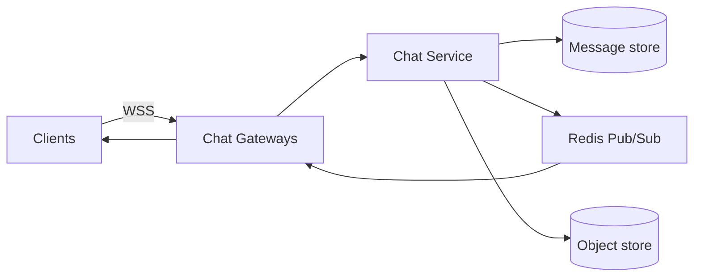

# Feishu (Lark) IM — 20 min NG design

> Hello Interview delivery, compressed: Requirements → Entities → API → HLD → **one or two** deep dives.
>
> **Is this WhatsApp?** Same *pattern* (realtime chat): persist the message, push if online, sync if not. **Not the same product.** Feishu is **enterprise IM inside a tenant** (company). WhatsApp is consumer, phone identity, default E2EE. If you design phone+E2EE+status, you missed the question.

Open with scope, or you will drown in Docs / Calendar / Meetings / Approval.

> I’d design **messaging**: 1:1 + group chat for users in one company, multi-device, history. Docs, calendar, video meeting, and org-wide search are out of scope unless you want one of those next.

Pattern: **realtime delivery** (WebSocket) + **durable log per conversation** + **inbox/sync**. Large groups reuse the **hybrid fan-out** idea from feed.

---

## 1. Requirements (~3 min)

### Functional (keep to 3)

Users should be able to:

1. Send **text** in a **1:1** or **group** chat (same company).
2. Receive it **immediately if online**; **catch up** after opening the laptop/phone.
3. Open a chat and see **history** (scroll back).

Nice-to-have if they ask (do not volunteer a laundry list): read state, @mention, image (presigned upload). Bots/cards, threaded replies, docs — out.

### Non-functional

| # | Requirement | Why it matters |
|---|---|---|
| 1 | Online send → other devices **< ~200ms** p99 | This is why WS exists |
| 2 | **Durability**: ACK to sender means the message is in the DB, not only on a socket | Same as WhatsApp / the agent-job outbox lesson |
| 3 | **Per-conversation order** (casual, not global) | Clients can render a sequence |
| 4 | One tenant can have **very large groups** (all-hands, 1k–10k) | This is the Feishu-specific scaling hole |
| 5 | Availability over cross-chat linearizability | Chat can be a second late; losing a committed message cannot |

CAP on a **single conversation’s history**: prefer the write to land; push can drop (client syncs).

### Capacity (only if it changes boxes)

Assume one large company: **50k seats**, 50 messages/user/day → ~2.5e6/day → **~30 QPS average**, **~200 QPS peak**. API is easy.

Pain is **connections + large-group fan-out**, not QPS:

- 50k users × 1.5 devices ≈ **75k WebSockets**
- All-hands 10k members × one announcement = **10k inbox writes + 10k pushes** if you naively fan-out-on-write

---

## 2. Core entities (~1 min)

- **Tenant** — the company. All queries are tenant-scoped.
- **User** — employee id, not phone.
- **Conversation** — `DIRECT` (two users) or `GROUP`.
- **Membership** — user ↔ conversation.
- **Message** — `conversation_id`, `seq`, sender, body, `created_at`.

WhatsApp analogue: Conversation ≈ chat, Message ≈ message. Extra: **Tenant**. Missing: E2EE keys as a first-class design (enterprise default is **server-side storage** so admin/compliance/search can exist). If they insist on E2EE, say “optional for secret chats; default IM is plaintext-at-rest with encryption in transit + at-rest disk encryption.”

---

## 3. API (~2 min)

REST for history; **WebSocket** for live. User from auth token.

```
POST /v1/conversations/{conversationId}/messages
body: { "client_msg_id": uuid, "text": string }
→ 200 { "message_id", "seq", "created_at" }

GET /v1/conversations/{conversationId}/messages?after_seq=&limit=
→ 200 { "messages": [...] }          // catch-up / history

GET /v1/inbox?cursor=                 // list chats + last message + unread
```

WebSocket (after gateway auth):

```
→ { type: "send", conversation_id, client_msg_id, text }
← { type: "ack", client_msg_id, message_id, seq }
← { type: "message", ... }            // pushed to other devices / members
```

`client_msg_id`: sender retries after a blip without duplicating the row (unique with `sender_id`).

Media later: presigned PUT to object store, message body is `file_id`, same as Instagram upload — not through the chat server.

---

## 4. Data flow (say it once)

**Send (online)**

1. Client WS → **Chat Gateway** (the server that holds this socket).
2. Gateway → **Chat Service**: auth, “is member?”, persist **Message** with next `seq`.
3. ACK sender.
4. **Live fan-out**: Pub/Sub `user:{id}` for members currently connected.
5. Each gateway that holds a socket writes the frame to that device.

**Offline / missed push**

Pub/Sub is **at-most-once**. Bob reconnects → `GET messages?after_seq=last_acked`. DB is source of truth.

Do **not** use Kafka as the live “which box holds Bob’s socket” router. Kafka is fine for audit/search consumers; live path is Redis Pub/Sub (or Redis Streams if you want a short buffer). Same argument as in `classic_problems.md` WhatsApp notes.

---

## 5. High-level design (~6 min)

Walk **send**, then **reconnect**. Stop. Large group is the deep dive.

```text
 Phone / Lark desktop
        │  WSS (sticky per connection, not per user)
        v
 [GW] Chat Gateway  × N     ← holds sockets; stateless otherwise
        │
        v
 Chat Service               ← membership check, seq, persist
        │
        +--→ Message DB     (Cassandra / Dynamo / sharded MySQL)
        +--→ Redis Pub/Sub  channel user:{userId}   // live only
        +--→ Object store   // images, files
        +--→ (optional) Kafka → search / compliance archive
```



### What each box is for

| Box | Role |
|---|---|
| **Gateway** | Terminate TLS/WS. Does **not** own message history. |
| **Chat Service** | Durable write + fan-out trigger. |
| **Message store** | Source of truth. Partition by `conversation_id` so a chat’s seq stays on one shard. |
| **Redis Pub/Sub** | **Routing**, not storage. `user:Bob` → whichever gateways subscribed. |
| **Inbox / unread** | Last message, unread count per `(user, conversation)`. |

### Schema (only what you will point at)

**Message:** `PK = (conversation_id, seq)`, `message_id`, `sender_id`, `tenant_id`, `body`, `client_msg_id`, `created_at`.

**Membership:** `(conversation_id, user_id)`.

**User inbox** (for the chat list): `(user_id, conversation_id) → last_seq, unread, updated_at`.

Seq: `INCR conversation:{id}:seq` in Redis then persist, or DB `MAX(seq)+1` on the conversation partition. Interview: Redis INCR + write DB; if Redis dies, fall back to DB and accept a rare gap you don’t reuse.

### Why gateways are split from “chat service”

Alice on GW-A, Bob on GW-B. A **cannot** write Bob’s socket. After persist, **publish `user:Bob`**; GW-B is subscribed because Bob connected there.

Multi-device: phone on GW-A, laptop on GW-C, **both** subscribe `user:Alice`. Her own send still ACKs locally; other devices get the pub (or they sync `after_seq`).

---

## 6. Deep dives (pick 1–2; this is the 20 min)

### 6.1 Different WS servers (they will ask; same as WhatsApp)

You already have this in `classic_problems.md`. Speak it:

> Persist first, then `PUBLISH user:{id}`. Pub/Sub does not store history. If Bob’s gateway misses it, reconnect syncs from `after_seq`. Shard Redis by `userId` so publish and subscribe hit the same shard. Not Kafka for this hop.

### 6.2 Feishu ≠ WhatsApp: large groups (the distinctive dive)

WhatsApp groups are usually small → **fan-out-on-write**: on send, write once to the conversation log **and** bump every member’s inbox / push every `user:{id}`.

Feishu all-hands (5k–50k) makes that write amplification the Instagram celebrity problem.

**Hybrid:**

| Group size | Live push | Inbox / unread |
|---|---|---|
| Small (e.g. &lt; 200) | Pub/Sub every online member | Fan-out update each inbox row |
| Large | Do **not** publish 10k channels. Members who have the chat **open** subscribe `conv:{id}`; others get nothing live | **Do not** write 10k inbox rows on every message. On **open chat / poll inbox**, read `conversation.last_seq` vs `membership.last_read_seq` |

Conversation row holds `last_seq`, `last_preview`. Inbox list for a user who rarely opens all-hands: compute unread as `conv.last_seq - last_read` when they load the list (cache that), instead of O(members) writes per message.

Online users with the **group window focused**: subscribe `conv:{bigId}` (one channel, N subscribers) rather than N times `user:{id}` from the sender path.

### 6.3 Offline catch-up (if they go here)

Client stores `last_seq` per conversation (or a global user cursor + per-chat). On connect:

```
GET /messages?after_seq=  for each dirty chat
```

Or: server keeps `user_inbox` for small chats (updated on write) and **pulls large chats on demand**.

Push notification (mobile background): APNs/FCM **after** persist, async, not on the WS path. Dedup with `message_id`.

### 6.4 What you should *not* copy from WhatsApp

| WhatsApp | Feishu IM |
|---|---|
| Phone number is identity | SSO / employee id, **tenant_id on every row** |
| Default E2EE, server can’t read | Default **server stores plaintext** (or company keys) so search, DLP, eDiscovery work |
| Broadcast lists / status | Skip |
| Small groups assumed | **Must** talk about 1k+ member groups |

If they say “design 飞书” and you only draw WhatsApp, call the delta yourself: tenant, no E2EE, large-group fan-out.

---

## 7. 20-minute script

1. **Scope (30s):** IM only, 1:1 + group, one company, multi-device. Not Docs/Meet.
2. **FR/NFR (2 min):** send, live or sync, history; 200ms; durable ACK; large groups.
3. **API + boxes (6 min):** WS gateway, chat service, message DB keyed by conversation, Redis Pub/Sub `user:{id}`, persist-then-push.
4. **Walk one send** Alice→Bob on two gateways.
5. **Ask:** “1:1 vs all-hands — which do you want?” → hybrid fan-out.
6. **If time:** `client_msg_id`, media presigned URL, Kafka for compliance off the hot path.

Do not start with Cassandra vs MySQL holy war. Say: **partition messages by `conversation_id`**, inbox by `user_id`.

---

## 8. One-liner

> Same realtime-chat skeleton as WhatsApp: WebSocket gateways, durable log, Redis Pub/Sub as a live router, sync by seq if push drops. Feishu adds **tenant isolation**, **company-readable storage**, and **hybrid fan-out** because org groups can be huge. I would not put cancel/job queues in this design unless they asked for bots that run long tasks inside the chat.
